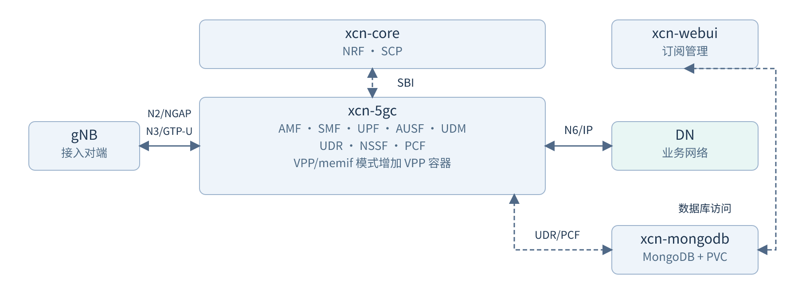

# XCN 核心网产品说明书

**纯软件部署说明｜V1.0（修订版）｜2026-10-23**

适用版本：xcn 2.7.7，XCN Helm Chart 0.1.0。实际交付内容为相关容器镜像及 Helm Chart 包 `xcn.tgz`，部署参数以交付包中的配置为准，包版本可通过 `helm show chart ./xcn.tgz` 查看。

## 1. 软件概述

XCN 是基于 xcn 的 5G SA 核心网软件，通过 Kubernetes 和 Helm 部署，提供用户注册与鉴权、PDU 会话管理、用户面转发、策略控制及订阅管理。gNB 通过 N2、N3 接入核心网，用户数据经 N6 进入数据网络（DN）。

### 1.1 软件组成

| 工作负载 | 包含组件 | 主要用途 |
| --- | --- | --- |
| xcn-core | NRF、SCP | 网元服务注册、发现与通信代理 |
| xcn-5gc | AMF、SMF、UPF、AUSF、UDM、UDR、NSSF、PCF | 用户接入、鉴权、会话、转发、订阅服务、切片及策略控制 |
| xcn-webui | Web 管理界面 | 用户订阅及管理账号操作 |
| xcn-mongodb | MongoDB 与持久卷 | 保存用户订阅及管理账号等数据 |



图中各工作负载默认均为单副本。SMF 与 UPF 位于同一个 Pod，N4 通信使用 Pod 内部回环地址；VPP/memif 模式在 xcn-5gc 中增加 VPP 容器。当前 Chart 部署 5GC，不部署 EPC 或 IMS。

### 1.2 用户面部署方式

| 模式 | 数据路径 | 适用条件 |
| --- | --- | --- |
| UDP/TUN | N3 使用 Linux UDP，N6 使用 ogstun 及 Linux 路由／NAT | 无需 SR-IOV VF，作为本文主要部署流程 |
| VPP/memif | UPF 通过两侧 memif 与 VPP 连接，VPP 经 DPDK 使用 N3、N6 两个 VF | 已具备 VF、设备插件、大页及 CPUSet 分配条件的环境 |

## 2. 部署环境要求

### 2.1 硬件资源

以下合计依据当前 Chart 中核心网、WebUI 和 MongoDB 的常驻业务容器计算，CPU 单位为逻辑核，内存采用 GiB；不包含 Kubernetes、CNI、存储组件及其他业务的开销。

| 项目 | UDP/TUN | VPP/memif |
| --- | --- | --- |
| 处理器架构 | 已验证的部署环境为 x86_64 | x86_64，并满足网卡驱动及设备直通条件 |
| CPU 请求／限额合计 | 8.7／13.25 核 | 10.7／15.25 核 |
| 普通内存请求／限额合计 | 8.5／17 GiB | 24.5／33 GiB |
| 大页 | 无额外大页请求 | 额外预留 8 GiB 的 1 GiB 大页 |
| 数据库存储 | 默认 PVC 为 1 GiB；按订阅数据量扩容 | 同左 |
| 额外磁盘空间 | 可容纳容器镜像、日志、数据库增长及备份 | 同左，另需 VPP 镜像 |
| 网络设备 | 可达 gNB 和 DN 的 IP 网络接口 | 两个可分配的 SR-IOV VF，分别用于 N3、N6 |

节点可分配资源应覆盖 Pod 调度请求；长期运行时还需为内存增长、容器限额和平台开销保留余量。大页从物理内存中预留，不可与普通可用内存重复计算。上述资源值是当前部署配置，不代表吞吐量或并发用户能力。

关键容器的默认内存请求／限额分别为：UPF 4／4 GiB、SMF 1／4 GiB、AMF 1／4 GiB。不能仅依据刚启动时的内存占用缩减配置。

### 2.2 软件环境

| 组件 | 部署要求 |
| --- | --- |
| Linux | 参考环境为 Ubuntu 22.04、x86_64；内核支持 SCTP；TUN 模式具有 `/dev/net/tun` |
| Kubernetes | 集群已安装，节点 Ready，CNI 与集群 DNS 正常；参考验证版本为 v1.26.8 |
| 容器运行时 | 镜像可由 kubelet 使用；参考环境为 containerd 1.6.32 |
| 管理工具 | kubectl、Helm 3；参考 Helm 版本为 v3.17.3；安装示例使用 openssl 生成 WebUI 参数 |
| 持久化存储 | 已提供可用 StorageClass；Chart 默认使用 `local-path`，也可在 values 中指定其他 StorageClass |
| UPF 运行权限 | 当前 Chart 使用特权容器及 NET_ADMIN，TUN 模式挂载 `/dev/net/tun`；集群须允许该配置 |
| 系统时间 | 节点使用一致的时间源，便于跨网元日志与事件关联 |

表中版本是已验证的参考组合，其他版本需验证镜像、CNI、SCTP、存储及 Chart 的兼容性。

VPP/memif 模式还需要以下条件：

- VPP 26.06 及包含匹配 libmemif 的 XCN 运行镜像。
- 两个可供 VPP／DPDK 使用的 VF，完成设备插件及 VFIO／IOMMU 等平台配置。Chart 默认资源名为 `intel.com/fabric_network`。
- 平台提供 CPUSet 准入与分配组件，为带 `xnet.com/cpuset-required` 标签的 Pod 写入 `xnet.com/used-core` 分配注解。默认启动保护核对 upf、vpp、smf 的分配信息；该外部组件不由本 Chart 安装。
- 默认 UPF 分配 4 核，解析为 1 个 Session Worker；VPP 另分配 2 核。修改 UPF 核数时，两侧 memif 队列数需与解析出的 Worker 数一致。

部署前执行基础检查：

```bash
uname -m
kubectl get nodes -o wide
kubectl get pods -A
kubectl get storageclass
helm version --short
openssl version
ip -br addr
ip route
# 在准备运行 TUN 模式 UPF 的节点执行。
test -c /dev/net/tun
```

### 2.3 网络与业务参数

本文以单节点 `hostNetwork` 部署为例，节点名为 `xnet-server`，节点 IP 为 `10.2.0.119`。实施时应同时替换节点名、IP 和相关网关；UE 网段不得与节点、Pod、Service 或业务网络重叠。

| 网络用途 | 协议／端口 | 配置要求 |
| --- | --- | --- |
| N2：gNB－AMF | SCTP 38412 | gNB 可达 AMF 配置地址，且支持 NG Setup |
| N3：gNB－UPF | UDP 2152 | gNB 可达 UPF 广告地址，双向路径正确 |
| N4：SMF－UPF | UDP 8805 | 同 Pod 内使用 SMF 127.0.0.4、UPF 127.0.0.7，无需对外开放 |
| N6：UPF－DN | 按业务使用 IP 通信 | 具备 DN 出口和返回 UE 的路由，或采用对应模式的 NAT |
| WebUI | TCP 9999 | 管理终端可达；默认配置使用 HTTP |
| SBI／MongoDB | 集群 Service TCP 7777／27017 | 集群 DNS、Service 和 Pod 网络可用 |

Chart 还提供 N2 NodePort 31412、N3 NodePort 32152、PCF NodePort 30777。本文的 hostNetwork 示例直接使用 N2／N3 配置地址及标准端口。改用 Pod 网络或 NodePort 时，需另行确认 CNI 对 SCTP 的支持、N3 广告地址和端口映射。

| 业务参数 | 当前配置／示例 | 对接要求 |
| --- | --- | --- |
| PLMN | 模板配置 46011、46000、46001 | 采用项目实际标识，核心网、gNB、UE 一致 |
| TAC | 模板为 0、1；本文示例使用 1 | 与 gNB 对接配置一致 |
| 切片 | SST=1、SD=010101 | 与 gNB、UE 及订阅一致，保留 SD 的前导零 |
| DNN | 示例使用 cmnet | 在用户订阅和 UE 侧配置同一名称 |
| UE IPv4 网段／网关 | 10.45.0.0/16／10.45.0.1 | 由 SMF、UPF/TUN 或 VPP 内侧共同使用 |
| 动态 IPv4 范围 | 本文设置 10.45.1.2-10.45.255.254 | 静态订阅地址应避开动态范围、网关及网络／广播地址 |

当前 Chart 未提供通用 PLMN／TAC values 参数，部署时采用交付包中的预置配置；如需更换，应提供相应配置的新版 Chart 包。UE 容量模板值 `global.max.ue=1024` 为资源池配置。

## 3. 安装与部署

### 3.1 准备部署包与镜像

交付的 Chart 经 `helm package xcn` 打包，以 `xcn.tgz` 文件提供；镜像包括 XCN 运行镜像、WebUI 和 MongoDB，VPP/memif 模式另需 VPP 镜像。以下以交付文件放在 `/opt/xcn` 为例，离线归档的目录示例为：

```text
/opt/xcn/
├── xcn.tgz
└── images/
    ├── xcn-runtime.tar
    ├── xcn-webui.tar
    ├── mongo.tar
    └── vpp.tar
```

在管理终端进入实际部署目录，检查 Chart 版本并导出默认参数供核对。Helm 直接读取 `xcn.tgz`，现场参数通过独立 values 文件覆盖：

```bash
cd /opt/xcn
helm show chart ./xcn.tgz
helm show values ./xcn.tgz > /tmp/xcn-default-values.yaml
```

可使用镜像仓库或导入离线镜像。以下为 containerd 环境的归档导入示例，需在可能调度工作负载的各节点执行，并以实际交付的文件名和镜像标签为准：

```bash
sudo ctr -n k8s.io images import images/xcn-runtime.tar
sudo ctr -n k8s.io images import images/xcn-webui.tar
sudo ctr -n k8s.io images import images/mongo.tar
# 选择 VPP/memif 时导入 VPP 镜像。
sudo ctr -n k8s.io images import images/vpp.tar
sudo ctr -n k8s.io images list
```

Docker 与 containerd 的镜像存储通常分离；仅执行 `docker load` 不能保证 Kubernetes 已能使用镜像。部署 values 中的 repository、tag、pullPolicy 应与实际镜像一致。下文的 `latest` 为 Chart 默认示例标签，交付时应填写实际验证版本。

### 3.2 部署 UDP/TUN 模式

在新环境创建 `/tmp/xcn-site-tun.yaml`。节点名和地址对应第 2.3 节示例，StorageClass 及镜像按实际环境修改：

```yaml
nodeSelector:
  kubernetes.io/hostname: xnet-server
fivegc:
  hostNetwork:
    enabled: true
mongodb:
  persistence:
    enabled: true
    size: 1Gi
    storageClassName: local-path
images:
  runtime:
    repository: xcn-runtime
    tag: latest
  webui:
    repository: xcn-webui
    tag: latest
  mongodb:
    repository: mongo
    tag: latest
networking:
  amf:
    ngap:
      serverAddress: 10.2.0.119
  ue:
    ipv4Subnet: 10.45.0.0/16
    ipv4Gateway: 10.45.0.1
  smf:
    ipv4PoolRanges:
      - 10.45.1.2-10.45.255.254
  upf:
    mode: tun
    n3:
      address: 10.2.0.119
```

hostNetwork 模式中，AMF 和 TUN 模式 UPF 的监听地址应已配置在选定节点上。UPF 不得使用 `0.0.0.0:2152` 或 `127.0.0.4:2152`，避免与同 Pod 内 SMF 的 GTP-U 端点冲突。

先检查参数并生成清单：

```bash
helm lint ./xcn.tgz -f /tmp/xcn-site-tun.yaml
umask 077
helm template xcn ./xcn.tgz -n xcn \
  -f /tmp/xcn-site-tun.yaml > /tmp/xcn-rendered-tun.yaml
```

确认清单中的节点、地址、镜像和资源后首次安装。命令为 WebUI 生成独立的会话签名参数，升级时沿用原值：

```bash
helm install xcn ./xcn.tgz -n xcn --create-namespace \
  -f /tmp/xcn-site-tun.yaml \
  --set-string webui.secretKey="$(openssl rand -hex 32)" \
  --set-string webui.jwtSecretKey="$(openssl rand -hex 32)" \
  --wait --timeout 10m
```

启动脚本会创建并启用 `ogstun`，配置 UE 网关、IP 转发及相应的 IPv4 NAT／转发规则。hostNetwork 模式下这些配置作用于节点网络，应在启动后核对实际路由和规则。已有同名 Release 时，采用第 4.4 节的升级流程，保留原有参数。

### 3.3 部署 VPP/memif 模式

完成第 2.2 节中的额外条件后，复用基础文件的节点、镜像和业务配置，增加 `/tmp/xcn-site-memif.yaml`：

```yaml
networking:
  upf:
    mode: memif
    n3:
      address: 10.2.0.230
vpp:
  image:
    repository: vpp
    tag: "26.06"
  n3:
    interfaceAddress: 10.2.0.231/20
    defaultGateway: 10.2.7.254
  n6:
    externalAddress: 10.2.0.232/20
    defaultGateway: 10.2.7.254
```

三个地址含义不同：`10.2.0.230` 为 UPF 对 gNB 广告的 N3 地址，`10.2.0.231/20` 为 VPP N3 外侧地址，`10.2.0.232/20` 为 VPP N6 外侧地址。示例下一跳需替换为现场实际网关；直连网络可将相应 defaultGateway 留空。

检查组合配置并在新环境安装，后一个文件覆盖前一个文件的同名参数：

```bash
helm lint ./xcn.tgz -f /tmp/xcn-site-tun.yaml \
  -f /tmp/xcn-site-memif.yaml
umask 077
helm template xcn ./xcn.tgz -n xcn \
  -f /tmp/xcn-site-tun.yaml -f /tmp/xcn-site-memif.yaml \
  > /tmp/xcn-rendered-memif.yaml
helm install xcn ./xcn.tgz -n xcn --create-namespace \
  -f /tmp/xcn-site-tun.yaml -f /tmp/xcn-site-memif.yaml \
  --set-string webui.secretKey="$(openssl rand -hex 32)" \
  --set-string webui.jwtSecretKey="$(openssl rand -hex 32)" \
  --wait --timeout 10m
```

memif 模式由 VPP 的 VF／memif 路径收发 N3、N6 数据，不用宿主 UDP 监听判断 N3 是否正常。若从 TUN 切换，应检查原主机 N3 地址及路由，避免本地路径截获本应交给 VPP 的流量。

### 3.4 配置用户订阅并对接 gNB／UE

在管理终端运行以下命令后，访问 `http://127.0.0.1:9999`，使用交付的管理凭据登录 WebUI：

```bash
kubectl -n xcn port-forward svc/xcn-webui 9999:9999 \
  --address 127.0.0.1
```

1. 新增或编辑订阅，录入与 SIM 对应的 IMSI、鉴权资料和 OP／OPc 类型。
2. 在订阅中配置 SST／SD、DNN、会话类型及 QoS；使用静态 IPv4 时核对地址是否重复或与动态池重叠。
3. 在 gNB 配置 AMF 地址、N2 端口、N3 地址、PLMN、TAC 和切片，在 UE 配置一致的身份、DNN 和切片。
4. 先确认 gNB 完成 NG Setup，再让 UE 注册并建立 PDU 会话。

变更会话相关订阅后，应让 UE 重新建立会话。需要 UE 后方网段时，在对应 Session 的 IPv4 Framed Routes 中配置 CIDR，同时配置 UE、Linux／VPP 和 DN 的双向路由；页面保存不会自动完成这些路由配置。

## 4. 部署验证与维护

### 4.1 检查工作负载

```bash
kubectl -n xcn get pods -o wide
kubectl -n xcn get svc,pvc
kubectl -n xcn rollout status deploy/xcn-core --timeout=600s
kubectl -n xcn rollout status deploy/xcn-5gc --timeout=600s
kubectl -n xcn rollout status deploy/xcn-webui --timeout=600s
```

正常情况下，xcn-core 为 2 个容器就绪；xcn-5gc 在 TUN 模式为 8 个、memif 模式为 9 个；WebUI、MongoDB 各 1 个，数据库 PVC 为 Bound。容器就绪后还应继续检查 gNB、UE 会话和真实业务。

TUN 模式检查接口、UDP 监听和 NAT：

```bash
kubectl -n xcn exec deploy/xcn-5gc -c upf -- ip -d addr show ogstun
kubectl -n xcn exec deploy/xcn-5gc -c upf -- ss -lunp
kubectl -n xcn exec deploy/xcn-5gc -c upf -- \
  iptables -t nat -S POSTROUTING
```

memif 模式检查 VPP 接口、memif 连接及路由：

```bash
kubectl -n xcn exec deploy/xcn-5gc -c vpp -- vppctl show interface
kubectl -n xcn exec deploy/xcn-5gc -c vpp -- vppctl show memif
kubectl -n xcn exec deploy/xcn-5gc -c vpp -- vppctl show ip fib
```

### 4.2 检查接入、会话与业务

```bash
kubectl -n xcn exec deploy/xcn-5gc -c upf -- xcnctl show gnb --detail
kubectl -n xcn exec deploy/xcn-5gc -c upf -- xcnctl show ue --detail
kubectl -n xcn exec deploy/xcn-5gc -c upf -- \
  xcnctl show rate --level session --active-only
```

核对基站连接、用户身份、DNN、切片、UE IPv4 和活动 PDU 会话。随后从 UE 业务接口访问指定 DN，验证上下行数据与返回路径；宿主机或 UPF 自身可达 DN 不能替代 UE 业务验证。

需要排查单用户流程时，可使用以下查询，SUPI 替换为实际用户：

```bash
kubectl -n xcn exec deploy/xcn-5gc -c upf -- \
  xcnctl show ue-event --supi imsi-460110000000100 \
  --since 30m --limit 200
```

`show rate` 支持 user、session、bearer、rule 层级，可加 `--watch` 连续观察；`--detail` 仅用于 UE／gNB 详情。事件历史为有界内存，网元重启会清除，事件时间使用 UTC。

### 4.3 常见问题

| 现象 | 优先检查 |
| --- | --- |
| Pod Pending | 节点选择、CPU／内存请求、PVC；memif 模式另查大页、VF 与 CPUSet 分配 |
| ImagePullBackOff | 镜像名称和标签、节点镜像导入、仓库可达性及 pullPolicy |
| 反复启动或 OOMKilled | 容器退出原因、前一实例日志、端口冲突、运行权限及实际内存限额 |
| gNB 无法接入 | AMF 地址、SCTP/38412 双向通信，PLMN／TAC／切片及 NG Setup 结果 |
| UE 注册失败 | gNB 连接、SIM 与订阅数据、AUSF／UDM／UDR、MongoDB 和网元通信 |
| 已注册但无数据 | DNN、PDU 状态、N4、N3 地址与 TEID，N6 路由／NAT／DN 回程 |
| 小包正常、大报文不通 | 全路径 MTU、分片／PMTU、TCP MSS 和实际业务抓包 |
| 主机或容器网络异常 | 路由、DNS、代理环境变量及 clashctl／Clash 透明转发；核对本机、集群及业务网段是否直连 |

常用定位命令，`POD_NAME` 替换为实际名称：

```bash
kubectl -n xcn describe pod POD_NAME
kubectl -n xcn get events --sort-by=.metadata.creationTimestamp
kubectl -n xcn logs deploy/xcn-5gc -c smf --tail=100
kubectl -n xcn exec deploy/xcn-5gc -c upf -- \
  tail -n 100 /var/log/xcn/amf.log
```

DPDK 的 VF 流量可能绕过 Linux 抓包路径，memif 模式还应结合 VPP 接口计数、错误、FIB 与邻居状态判断。

### 4.4 升级与卸载

升级前保存原 `xcn.tgz`、实际 Release 参数和数据库备份。以下命令在部署目录执行，目录变量由本次操作创建，后续命令使用同一目录：

```bash
umask 077
XCN_BACKUP_DIR="$HOME/xcn-backup/$(date +%Y%m%d-%H%M%S)"
install -d -m 700 "$XCN_BACKUP_DIR"
cp ./xcn.tgz "$XCN_BACKUP_DIR/xcn.tgz"
helm get values xcn -n xcn --all > "$XCN_BACKUP_DIR/values.yaml"
kubectl -n xcn exec statefulset/xcn-mongodb -- \
  mongodump --db xcn --archive --gzip \
  > "$XCN_BACKUP_DIR/xcn.archive.gz"
test -s "$XCN_BACKUP_DIR/xcn.archive.gz"
```

需要一致性备份时，先停止相关数据库写入。完成备份后导入新版交付镜像，并用新版 `xcn.tgz` 替换部署目录中的 Chart 包。在已保存的 values 基础上修改形成 `/tmp/xcn-approved-values.yaml`，保持现场密钥、地址、存储和用户面参数，按新版镜像更新 repository、tag，再执行：

```bash
helm lint ./xcn.tgz -f /tmp/xcn-approved-values.yaml
helm upgrade xcn ./xcn.tgz -n xcn \
  -f /tmp/xcn-approved-values.yaml --wait --timeout 10m
```

当前 5GC 为单实例重建部署，升级或重建后按第 4.1、4.2 节重新验证，并安排 UE 重新接入。仅更新 ConfigMap 或 Secret 时，还需确认相关进程是否重新读取配置。

停止使用时卸载 XCN：

```bash
helm uninstall xcn -n xcn
kubectl -n xcn get pvc
```

数据库 PVC 是否保留以实际存储策略为准。hostNetwork 模式产生的 ogstun、地址、路由和 NAT 规则可能继续存在，卸载后按原部署记录检查并处理。
