# 5G 通信组网与运维培训

**半天入门课程与课后操作手册｜V1.0｜2026-10-25**

适用对象：会使用基本 Linux 命令，希望理解云原生 5G 部署、组网与排障的研发、测试和运维同事。课程以 xnet-server 为参考环境，业务实现以当前 Open5GS/XCN 仓库及提供的自研基站、模拟终端说明为依据。

学习后应能完成四件事：说清容器与网络资源如何分配；画出一条业务报文的去回路径；判断在哪一跳封装或转换了 IP；用命令区分部署、连通性和性能问题。

## 阅读导航与课程安排

| 章节 | 课堂重点 | 建议时间 |
| --- | --- | --- |
| 1. NFVI 与服务器资源 | 物理核、NUMA、隔离池、PF/VF | 20 分钟 |
| 2. 容器与 Kubernetes | 镜像、Docker、Harbor、Helm、CNI | 35 分钟 |
| 3. Linux 路由、NAT 与网卡 | 去回路径、地址转换、链路速率 | 25 分钟 |
| 4. 5G 组网与数据路径 | 三种布线、两类 DN、TUN/memif、Wi-Fi | 50 分钟 |
| 5. 性能测试 | TCP/UDP、正反向、结果解读 | 25 分钟 |
| 6. Kuboard 与 k9s | 资源、事件、日志、配置 | 15 分钟 |
| 综合回顾与问答 | 根据现象选择下一条检查命令 | 10 分钟 |

正文用于讲解；附录 A 是速查与排障，附录 B 是部署示例，附录 C 是自研函数说明，附录 D 是来源与验证边界。首次出现的缩写会给出中文解释。

**命令约定**：`[查询]` 表示读取状态，`[实验变更]` 表示只在准备好的实验环境操作，`[负载]` 表示会产生测试流量。命令前说明执行位置；一个代码块内的变量需先赋值。示例地址必须替换为实验环境实际地址，不能把教学网段直接加到当前业务服务器。默认使用 IPv4 和 Ubuntu 22.04 的工具语法。

**图示约定**：业务图中的主箭头表示上行；下行沿相反顺序，具体地址见报文表。硬件图的上下行分别画出。虚线语义由图中文字说明。图中的无线/仿真连接仅表示接入关系，不推定自研仿真链路的传输协议。

## 1. NFVI 与标准服务器资源

### 1.1 先理解平台提供什么

NFVI（网络功能虚拟化基础设施）提供计算、内存、存储和网络资源，以及对这些资源的抽象与隔离。AMF、SMF、UPF、基站软件等网络功能运行在其上。容器化部署可以直接使用裸机 Linux；NFVI 并不意味着每个功能必须运行在虚拟机里。

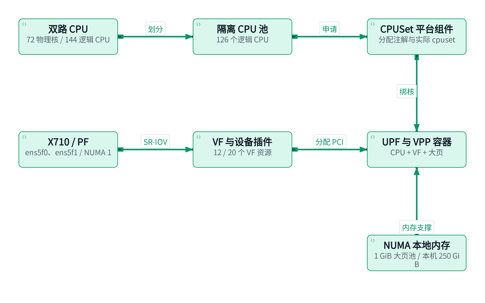

图 1 是资源关系图，连线表示资源支撑和分配关系。CPU、内存和网卡需要一起考虑 NUMA 位置；把线程绑到远离网卡的 CPU，仍可能付出跨 NUMA 访问开销。

| 术语 | 含义 | 本机例子或判断方式 |
| --- | --- | --- |
| Socket | 主板上的 CPU 插槽/处理器封装 | 2 个 |
| 物理核 | 真正的处理器核心 | 每颗 36 核，共 72 核 |
| 逻辑 CPU | Linux 可调度的 CPU 编号 | 每物理核 2 线程，共 144 个，编号 0–143 |
| 超线程/SMT | 一个物理核呈现多个逻辑 CPU | 两个线程共享部分执行资源，不等于两个独立物理核 |
| NUMA | CPU 与内存存在本地/远端访问差异 | 2 个 NUMA 节点 |
| 隔离核 | 从一般调度、部分中断等活动中隔离的 CPU 集合 | 需要结合内核参数、cpuset、中断与线程亲和性判断 |
| CPU 资源池 | 平台为特定业务管理的 CPU 集合 | 资源池名是分配策略，不增加物理计算资源 |
| Hugepage | 预留的大页内存 | 本机 250 GiB 的 1 GiB 大页；当前 VPP 请求 8 GiB |

### 1.2 本机 CPU 与 NUMA 解读

采集于 2026-10-25：CPU 为 Intel Xeon Gold 6554S，Ubuntu 22.04.3，内核 `5.15.148-rt74-rc202408`。

| 项目 | CPU 列表 | 逻辑 CPU 数 |
| --- | --- | --- |
| NUMA 0 | `0-35,72-107` | 72 |
| NUMA 1 | `36-71,108-143` | 72 |
| global_pool / 隔离集合 | `1-35,73-107,44-71,116-143` | 126 |
| 系统侧集合 | `0,72,36-43,108-115` | 18 |
| HiPHY 专用资源池 | `1-27,73-99` | 54，属于 global_pool |
| HiPHY_Asso 资源池 | `28-35,100-107` | 16，属于 global_pool |

54 与 16 是 126 的子集，不能计算成 `126 + 54 + 16`。本机兄弟线程编号相差 72，例如 CPU 0 与 72、44 与 116；这是本机拓扑，其他服务器须读取 `thread_siblings_list`，不能固定套用偏移量。

执行位置：服务器 Shell，`[查询]`。

```bash
lscpu
lscpu -e=CPU,CORE,SOCKET,NODE,ONLINE
cat /sys/devices/system/cpu/cpu44/topology/thread_siblings_list
cat /sys/devices/system/cpu/isolated
cat /sys/devices/system/cpu/nohz_full
cat /proc/cmdline
grep -E 'Huge|MemTotal|MemAvailable' /proc/meminfo
kubectl -n default get cm xnet-numa-config -o yaml
```

`isolcpus` 不是“这些 CPU 绝不执行任何系统任务”的承诺。`nohz_full`、`rcu_nocbs`、IRQ 亲和性、工作队列及业务绑核共同影响抖动。实时内核也不能替代资源规划。

### 1.3 Kubernetes CPU 请求与实际绑核

`requests.cpu: 1` 表示调度时申请 1 个 CPU 单位；`500m` 是 0.5。CPU limit 用来限制可用 CPU 时间，不能仅凭 `limits.cpu: 4` 就断言线程绑定了四个指定物理核。

本机 kubelet 的 `cpuManagerPolicy=none`、`topologyManagerPolicy=none`。当前使用自研 CPUSet webhook/controller，给 Pod 写入 `xnet.com/used-core`，再落实容器 cpuset；它与 Kubernetes 原生 CPU Manager `static` 策略是不同机制。原生策略的独占 CPU 条件不能直接套用到本环境。

| 当前 xcn-5gc 容器 | CPU 请求/限制 | 分配注解中的 CPU | 解读 |
| --- | --- | --- | --- |
| UPF | 5 / 5 | `44-46,116-117` | 5 个逻辑 CPU，涉及 3 个物理核 |
| VPP | 3 / 3 | `48-49,120` | 3 个逻辑 CPU，其中 48 与 120 是兄弟线程 |
| SMF | 1 / 1 | `47` | 1 个逻辑 CPU |

该 Pod 的 QoS 类别实际为 **Burstable**。个别容器的 CPU request 等于 limit，并不使整个 Pod 自动成为 Guaranteed。分配注解是平台意图，实际生效范围仍需核对进程和 cgroup。

执行位置：有集群访问权限的服务器 Shell，`[查询]`。

```bash
kubectl -n xcn get pod -l app=xcn-5gc \
  -o jsonpath='{.items[0].metadata.annotations.xnet\.com/used-core}{"\n"}'
kubectl -n xcn exec deploy/xcn-5gc -c vpp -- \
  sh -c 'grep Cpus_allowed_list /proc/1/status; cat /proc/1/cgroup'
kubectl -n xcn exec deploy/xcn-5gc -c vpp -- vppctl show threads
kubectl describe node xnet-server
```

关注 CPU、hugepage、VF 是否位于合适 NUMA 节点；同时检查兄弟线程争用、CPU quota 限流、worker 数和队列数。更多逻辑 CPU 不保证吞吐按比例增长。

### 1.4 PF、VF、SR-IOV 与 DPDK

PF（Physical Function）是物理功能，通常对应一个物理网口；VF（Virtual Function）是从 PF 派生的 PCI 功能。SR-IOV 让不同工作负载使用各自的 VF。多个 VF 仍共享 PF 的物理线速、部分硬件队列和 PCIe 资源，不会把一个 10G 口变成多个独立 10G 口。

本环境通过 `vfio-pci` 把 VF 交给 VPP/DPDK 用户态访问，Linux 不一定存在对应可供 `ip addr` 或 `tcpdump` 使用的 VF 网络接口。PF 可以继续由内核 `i40e` 驱动管理，承载主机管理流量。

| PF | PCI 地址 | NUMA | 已创建 VF / 硬件最大 VF | Kubernetes 资源名 |
| --- | --- | --- | --- | --- |
| ens5f0 | `0000:a8:00.0` | 1 | 12 / 64 | `intel.com/external_network` |
| ens5f1 | `0000:a8:00.1` | 1 | 20 / 64 | `intel.com/fabric_network` |

`sriovdp-config` 用 vendor `8086`、VF device `154c`、driver `vfio-pci` 与 PF/VF 编号范围筛选设备。`154c` 是 VF 设备标识，不能单凭它判断整张网卡型号；PF 实测为 X710、设备 ID `1572`。

执行位置：服务器 Shell，`[查询]`。

```bash
kubectl -n kube-system get cm sriovdp-config -o yaml
kubectl get node xnet-server \
  -o jsonpath='{.status.allocatable}{"\n"}'
cat /sys/class/net/ens5f0/device/sriov_numvfs
cat /sys/class/net/ens5f0/device/sriov_totalvfs
cat /sys/class/net/ens5f0/device/numa_node
readlink -f /sys/class/net/ens5f0/device/virtfn0
lspci -nnk -s a8:00.0
ip -d link show ens5f0
```

`capacity/allocatable` 是容量与可分配上限，不是实时空闲 VF 数。要结合节点上已调度 Pod 的 requests 和设备健康状态判断还能分配多少。当前 xcn VPP 申请 `intel.com/external_network: 2`，分别用于 N3 与 N6。

**常见问题**：Pod Pending 时先看 `describe pod` 的 Events；`Insufficient intel.com/...` 检查已占用 VF 与资源名；VF 可分配但业务不通时继续看 PF 链路、VF MAC/VLAN、驱动绑定及 VPP 接口状态。重新创建 VF、改驱动和关闭 PF 都会影响业务，不能作为随手查询命令执行。

## 2. 容器、镜像与 Kubernetes

### 2.1 一张图理解工具关系

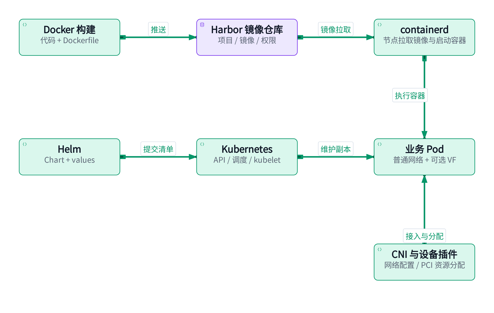

镜像是应用程序和依赖的分层交付包；容器是由镜像启动的进程及隔离环境。Harbor 保存和管理镜像，Helm 管理应用清单，Kubernetes 按清单调度和维护 Pod，节点上的 containerd 实际启动容器。Docker 可用于本机构建、调试与镜像操作。[镜像基础](https://docs.docker.com/get-started/docker-concepts/the-basics/what-is-an-image/)

| 对象 | 一句话理解 | 常见误解 |
| --- | --- | --- |
| Image / 镜像 | 应用及依赖的只读模板 | tag 可被重新指向；固定 tag 不一定固定内容 |
| Container / 容器 | 镜像运行起来的实例 | 停止或删除容器，不等于删除镜像 |
| Registry / Harbor | 镜像存储与访问服务 | Harbor 不负责调度 Pod |
| Pod | Kubernetes 最小调度单元，可含多个容器 | 同 Pod 容器共享网络命名空间，但不自动共享全部文件系统 |
| Deployment | 维护无状态应用副本与滚动更新 | 手动删除 Pod 后，控制器通常会补一个 |
| StatefulSet / PVC | 有状态副本管理与持久卷申请 | 卸载工作负载不一定删除 PVC 或数据 |
| Service | 为一组后端提供稳定访问入口 | Service 不是容器进程，也不一定经过所有业务流量 |
| ConfigMap / Secret | 配置 / 敏感数据对象 | Secret 的 base64 编码不是加密 |
| Namespace | 资源名称与管理范围 | 本身不保证网络隔离 |
| Chart / Release | Helm 模板包 / 一次安装实例 | 修改 values 文件不会自动更新运行中的 Release |

### 2.2 集群组件和本机版本

控制平面中的 API Server 接收请求，etcd 保存集群状态，Scheduler 选择节点，Controller Manager 持续使实际状态接近期望状态。节点上的 kubelet 管理 Pod，容器运行时执行容器操作；服务转发组件和 CNI 负责不同层面的网络功能。[Kubernetes 组件](https://kubernetes.io/docs/concepts/overview/components/)

本机快照：Kubernetes `v1.26.8`、containerd `1.6.32`、Helm `v3.17.3`，Calico `v3.26.1`、Multus `v3.8`。这些是环境事实，不是推荐升级目标；查阅新版文档时要核对本机帮助和版本支持范围。

执行位置：服务器 Shell，`[查询]`。

```bash
kubectl config current-context
kubectl get nodes -o wide
kubectl get pods -A -o wide
kubectl -n xcn get deploy,sts,svc,pvc
kubectl -n xcn describe pod -l app=xcn-5gc
kubectl -n xcn get events --sort-by=.metadata.creationTimestamp
kubectl -n xcn logs deploy/xcn-5gc -c upf --tail=100
kubectl -n xcn logs deploy/xcn-5gc -c upf --previous --tail=100
kubectl -n xcn exec deploy/xcn-5gc -c upf -- xcnctl show ue
kubectl -n xcn exec deploy/xcn-5gc -c upf -- xcnctl show gnb --detail
```

`--previous` 用于前一个已退出的容器实例，无历史实例时会报错。多容器 Pod 必须用 `-c` 明确容器。`kubectl top` 依赖 metrics-server；集群未安装时无法返回数据，不等于 CPU 使用率为零。

### 2.3 Docker 与镜像常用操作

执行位置：构建机或本机 Docker 环境。查询命令只读；build/run/load 会创建本地镜像或容器。

```bash
docker version
docker images
docker ps -a
docker image inspect xcn-runtime:latest
docker logs --tail=100 CONTAINER_NAME
# [实验变更] 在 Open5GS 仓库根目录构建
docker build --network host -f docker/runtime/Dockerfile \
  -t xcn-runtime:training-v1 .
docker save -o /tmp/xcn-runtime-training-v1.tar xcn-runtime:training-v1
docker load -i /tmp/xcn-runtime-training-v1.tar
# [实验变更] 临时检查镜像，退出后删除容器
docker run --rm --entrypoint /bin/sh xcn-runtime:training-v1 \
  -c 'command -v open5gs-upfd'
```

Docker 的本地镜像库与 Kubernetes 使用的 containerd 镜像库不应假定共用。`docker images` 能看到镜像，而 Pod 报 `ImagePullBackOff`，应检查真正运行 Pod 的节点运行时。

```bash
# [查询] 本机需要相应的运行时 socket 权限
sudo crictl images
sudo crictl ps
sudo ctr -n k8s.io images ls
# [实验变更] 离线镜像导入 Kubernetes 使用的 containerd 命名空间
sudo ctr -n k8s.io images import /tmp/xcn-runtime-training-v1.tar
```

实际镜像名称、tag/digest 和 `imagePullPolicy` 必须匹配；`Always` 仍可能需要访问镜像仓库解析引用。多节点环境需让每个候选节点都能拉取镜像，或者分别完成离线导入。

### 2.4 Harbor 的操作流程

Harbor 在 registry 基础上提供项目、权限、镜像扫描、复制和保留策略等管理能力。流程是“管理员准备项目和权限 → 开发者登录 → 给镜像打完整仓库 tag → 推送 → 部署引用该地址”。本机发现的 `registry:2` 容器只是普通 registry，不能因此把它称为 Harbor。

执行位置：已具备仓库账号、证书信任的构建机，`[实验变更]`。以下域名为占位示例。

```bash
REGISTRY=harbor.example.com
PROJECT=xnet
TAG=training-v1
docker login "$REGISTRY"
docker tag xcn-runtime:training-v1 \
  "$REGISTRY/$PROJECT/xcn-runtime:$TAG"
docker push "$REGISTRY/$PROJECT/xcn-runtime:$TAG"
docker pull "$REGISTRY/$PROJECT/xcn-runtime:$TAG"
docker logout "$REGISTRY"
```

`unauthorized/denied` 检查项目与账号权限；`x509` 检查节点运行时对 CA 的信任；HTTP/HTTPS 不匹配检查仓库和客户端配置。Docker 登录成功不代表 kubelet 已有拉取凭据，Pod 需正确引用所在 Namespace 的 `imagePullSecrets`。不要把密码写进课件或命令历史。[Harbor 推拉说明](https://goharbor.io/docs/2.14.0/working-with-projects/working-with-images/pulling-pushing-images/)

### 2.5 Helm：先看清配置，再管理 Release

Helm 将 Chart 默认值、values 文件与命令行覆盖值合并，渲染成 Kubernetes 对象。同一个参数通常以后提供的覆盖为准；合并规则与历史 values 保留行为应结合命令参数理解。

执行位置：仓库根目录，前半段 `[查询/离线渲染]`。

```bash
helm list -A
helm status xcn -n xcn
helm history xcn -n xcn
helm get values xcn -n xcn
helm show values ./helm/xcn
helm lint ./helm/xcn
helm template training ./helm/xcn -n training \
  --set networking.upf.mode=tun > /tmp/training-rendered.yaml
```

下面是操作形式，需准备自己的 `training-values.yaml`，只对实验 Release 执行。真实 XCN 可能使用 hostNetwork、固定端口或独占地址，换 Namespace 并不能消除端口/IP 冲突。

```bash
# [实验变更] 安装或更新；必须先检查渲染结果和实验资源
helm upgrade --install training ./helm/xcn -n training \
  --create-namespace -f training-values.yaml --wait --timeout 5m
# 查询 history 后，把 REVISION 改为确实存在的修订号
REVISION=1
helm rollback training "$REVISION" -n training --wait
# 卸载本实验；PVC/外部数据需按实际保留策略单独核对
helm uninstall training -n training
```

Helm 回滚应用清单不保证数据库内容或外部系统一起回滚。`helm get values` 里保留的旧键也不一定是最终生效行为：当前 Chart 在 `mode=memif` 时会派生启用 VPP、两侧 memif 和 worker，不能仅看到旧 `vpp.enabled=false` 就认定 VPP 没启动。以渲染清单和运行状态交叉确认。

### 2.6 CNI、Multus 与 SR-IOV Device Plugin

| 组件 | 负责的事情 | 本环境观察 |
| --- | --- | --- |
| Calico / 主 CNI | 普通 Pod 网络的接入、路由及相关策略 | 普通 Pod 有 `172.30.180.x` 地址 |
| Multus | 作为元插件，为 Pod 组织额外网络附件 | 集群有 Multus DaemonSet |
| SR-IOV Device Plugin | 发现设备、发布扩展资源、分配 VF/设备信息 | 发布 `intel.com/...` 资源 |
| SR-IOV CNI | 对分配到的 VF 进行网络配置 | 是否调用取决于 Pod 附件和部署方式 |
| VPP/DPDK | 按已分配 PCI 地址打开用户态设备并收发 | 本 Chart 读取设备环境变量并请求两个 VF |

“分配 PCI 设备”和“给 Linux 网络接口配 IP”是两件事。当前 XCN Chart 的 VF 使用以设备资源请求、`PCIDEVICE_...` 环境变量、VFIO 和 VPP 启动配置为依据，不能因为集群装有 Multus 就假定该 Pod 的所有流量都经过它。[设备插件](https://kubernetes.io/docs/concepts/extend-kubernetes/compute-storage-net/device-plugins/)；[SR-IOV 插件项目](https://github.com/k8snetworkplumbingwg/sriov-network-device-plugin)。

`hostNetwork=true` 让 Pod 使用主机网络命名空间，常用于 N2/SCTP 可达性；这不意味着 VPP 的所有 VF 报文回到 Linux IP 栈。管理面、普通 Pod 网络和高速用户面可以同时存在。

**课堂检查**：找出 xcn-5gc 中的 UPF 与 VPP 容器、当前 UE 地址及 SR-IOV requests；说明为什么 Docker 镜像可见、Pod 网络可达仍不足以证明 N3/N6 业务正常。

## 3. Linux 路由、NAT 与网卡检查

### 3.1 一个报文如何选出口

IP 地址标识三层端点；CIDR 描述地址前缀，例如 `192.168.2.0/24`。本机发送报文时，先依据策略规则选择路由表，再在表中做最长前缀匹配：`/32` 比 `/24` 更具体，缺省路由 `/0` 最宽泛。相同条件下才继续考虑 metric 等因素。

直连目的地址通常直接解析对端 MAC；跨网段流量发给下一跳网关的 MAC。**路由转发通常不改变源/目的 IP**，但会改变二层头，并递减 TTL。NAT 才会修改相关 IP/端口。配置了去程路由，也必须保证接收方有回程路由。

执行位置：需要检查路径的主机或容器网络命名空间，`[查询]`。

```bash
ip -br addr
ip -br link
ip route show
ip rule show
ip route show table all
ip route get 198.51.100.10
ip route get 198.51.100.10 from 10.45.0.2
ip neigh show
ss -lntup
```

`ip route get ... from ...` 的源地址要在该命名空间的实际语境中有效；命令报错时先核对源地址和规则。Linux 的查询结果只代表 Linux FIB，不代表 VPP 的 VRF/FIB。VPP 需使用 `show ip fib`、`show ip neighbors` 等命令。

### 3.2 静态路由与转发示例

假设 DN 主机地址为 `198.51.100.10/24`，核心网 N6 为 `198.51.100.1/24`，UE 网段为 `10.45.0.0/16`。核心网不开 NAT 时，在 DN 主机或其上游路由器配置“UE 网段经核心网 N6 返回”。

执行位置：DN 主机，接口名 `eth0` 仅为实验示例。`[实验变更]`，前提是该网段尚无需要保留的同名路由。

```bash
DN_IF=eth0
sudo ip route add 10.45.0.0/16 via 198.51.100.1 dev "$DN_IF"
ip route get 10.45.0.2
# 实验结束，删除本次新加路由
sudo ip route del 10.45.0.0/16 via 198.51.100.1 dev "$DN_IF"
```

只有真正承担 Linux 三层转发的节点才需要启用 `net.ipv4.ip_forward`；纯 VPP 转发路径不由这个开关直接控制。临时 `ip route` 修改通常重启失效，持久化需按本机 Netplan/systemd-networkd 等实际网络管理方式操作。

```bash
# [查询] Linux 转发节点
sysctl net.ipv4.ip_forward
sysctl net.ipv4.conf.all.rp_filter
sysctl net.ipv4.conf.default.rp_filter
```

`rp_filter` 是反向路径检查；严格模式遇到非对称路由可能丢包。要检查实际入接口与 all 的配置以及回程路径，不能把“全部关闭检查”作为第一步。VPP 也有独立的路由与特性配置。[Linux IP 参数](https://docs.kernel.org/networking/ip-sysctl.html)

### 3.3 NAT 是什么，解决什么问题

| 机制 | 改变什么 | 典型用途 |
| --- | --- | --- |
| SNAT | 源 IP，必要时源端口 | 内网通过出口地址访问外部网络 |
| MASQUERADE | 按出口接口地址进行源转换 | Linux 动态出口地址场景 |
| DNAT | 目的 IP，可能包括目的端口 | 端口映射、转发到内部服务 |
| 动态 NAPT/PAT | 为不同流建立 IP/端口映射 | 多个内部客户端共用一个出口 IP |
| 静态路由 | 决定下一跳，通常保留业务 IP | 对端能路由回 UE 或其后方网段 |

本手册的“动态 NAT 模式”指有状态动态地址/端口转换，不是动态路由协议。NAT 并没有取代路由：转换前后的查表、邻居解析、出口可达和返回状态仍需成立。

例如 `10.45.0.2:40000 → 198.51.100.10:5201` 在出口转换为 `198.51.100.1:p1 → 198.51.100.10:5201`。回复目的 `198.51.100.1:p1` 依据已有状态还原成 `10.45.0.2:40000`。`p1` 是动态映射端口，可能保持原端口，也可能改变。

DN 主动连接一个新的 UE 服务，与回复 UE 发起的连接不同。动态 NAT 通常不能仅凭外部目标 IP 知道该转给哪个内部终端；需静态映射、相应策略或采用可路由的方案。NAT 状态超时后，旧映射也可能失效。

### 3.4 Linux NAT 查询与独立实验示例

执行位置：Linux 转发/NAT 节点，`[查询]`。

```bash
sudo iptables --version
sudo iptables -t nat -L -n -v --line-numbers
sudo iptables -S FORWARD
sudo nft list ruleset
# 需安装 conntrack；不加 -F，避免清除已有连接
sudo conntrack -L -s 10.45.0.2
```

Ubuntu 上 `iptables` 可能使用 nft 后端，`iptables --version` 中的 `nf_tables` 表示兼容前端。查看输出前先认清后端；不要分别用两套命令重复维护同一条转换策略。

以下为**独立实验路由器**的最小 MASQUERADE 例子，接口 `lan0/wan0` 由实验自行准备。公网访问还取决于默认路由与 DNS；本例只演示转发与源 NAT。不得在已有复杂防火墙的主机上直接照搬。

```bash
LAN_IF=lan0
WAN_IF=wan0
LAN_CIDR=192.168.40.0/22
OLD_FORWARD=$(sysctl -n net.ipv4.ip_forward)
sudo sysctl -w net.ipv4.ip_forward=1
sudo iptables -A FORWARD -i "$LAN_IF" -o "$WAN_IF" \
  -s "$LAN_CIDR" -j ACCEPT
sudo iptables -A FORWARD -i "$WAN_IF" -o "$LAN_IF" \
  -d "$LAN_CIDR" -m conntrack --ctstate ESTABLISHED,RELATED -j ACCEPT
sudo iptables -t nat -A POSTROUTING -s "$LAN_CIDR" \
  -o "$WAN_IF" -j MASQUERADE
# 恢复本次新增规则及原转发开关
sudo iptables -t nat -D POSTROUTING -s "$LAN_CIDR" \
  -o "$WAN_IF" -j MASQUERADE
sudo iptables -D FORWARD -i "$WAN_IF" -o "$LAN_IF" \
  -d "$LAN_CIDR" -m conntrack --ctstate ESTABLISHED,RELATED -j ACCEPT
sudo iptables -D FORWARD -i "$LAN_IF" -o "$WAN_IF" \
  -s "$LAN_CIDR" -j ACCEPT
sudo sysctl -w net.ipv4.ip_forward="$OLD_FORWARD"
```

NAT 规则命中计数不等于全部业务字节数：有状态 NAT 通常在连接首包决定映射。确认业务应结合转发计数、conntrack、双端抓包和应用响应。

### 3.5 网卡型号、协商速率与实际吞吐

执行位置：物理服务器，`[查询]`。

```bash
lspci -nn | grep -i -E 'Ethernet|Network'
ethtool -i ens5f0
ethtool ens5f0
ip -s link show ens5f0
sudo ethtool -S ens5f0
cat /sys/class/net/ens5f0/speed
cat /sys/class/net/ens5f0/carrier
sudo lspci -vv -s a8:00.0
```

| 输出字段 | 怎么理解 | 本机观察 |
| --- | --- | --- |
| lspci / driver / bus-info | 型号、驱动、PCI 地址 | Intel X710 for 10GbE SFP+，i40e |
| Supported link modes | 网卡/模块报告的支持模式 | 可能是 Not reported；不等于支持速率为零 |
| Advertised / partner modes | 本端/对端通告的模式 | 取决于硬件、模块、驱动支持 |
| Speed / Duplex / Link detected | 当前链路速率、双工和连通状态 | ens5f0：1000Mb/s、Full、yes |
| ens5f1 Speed / Link | 第二口当前状态 | Unknown、no，不能按 10G 可用链路计算 |
| LnkCap / LnkSta | PCIe 能力与当前协商宽度/速率 | 可能成为多口总吞吐瓶颈 |

当前 `ens5f0` 是 10GbE 网卡上的 **1Gbps 活跃链路**。这可由模块、线缆、对端端口或配置等原因导致，但本次未据此判定具体原因。排查时同时核对交换机端口状态与收发错误。无链路时 `speed` 读取可能报错。

链路速率是线上的传输速率，应用有效吞吐还受协议头、包长、丢包、CPU、PCIe、NUMA、队列、无线链路和 QoS 限制。`1 Gbit/s ÷ 8 = 125 MB/s` 只是单位换算后的理论数值，不是应用必达速率。VF 共用 PF 带宽；同主机 VF 间的硬件交换路径也可能不经过外部线缆，压测前要确认真实路径。

**常见问题**：接口显示 UP 但无流量，继续看 LOWER_UP/carrier、协商速率、VF link state、MAC/VLAN 和收发计数；ping 能通但 TCP 大包卡住，检查 MTU、PMTUD、MSS 与代理；仅修改 Linux 路由无法改变完全由 VPP 管理的数据路径。

## 4. 5G 组网与数据路径

### 4.1 角色、接口与教学地址

UE 是终端，gNB 是基站，AMF 负责接入与移动性，SMF 管理 PDU 会话，UPF 承担用户面规则处理和转发，DN 是业务所在的数据网络。N2 连接 gNB 与 AMF（NGAP/SCTP，常见服务端口 38412）；N3 连接 gNB 与 UPF（GTP-U/UDP 2152）；N4 连接 SMF 与 UPF（PFCP/UDP 8805）；N6 连接 UPF 用户面与 DN。

PDU 会话建立时，终端获得业务地址，并建立相关隧道/规则。控制面负责“允许谁、怎样通信”；用户面承载手机/电脑的应用数据。**业务走基站边缘分流，仍需要核心网完成所需的接入和会话控制**。

| 教学角色 | 地址或网段 | 用途 |
| --- | --- | --- |
| 基站 / AMF 控制面 | `192.168.1.10` / `192.168.1.20`，`/24` | N2 |
| 基站 / UPF N3 | `192.168.2.10` / `192.168.2.20`，`/24` | GTP-U 外层地址 |
| 核心 VPP N3 接口 | `192.168.2.21/24` | 为 UPF `.20` 提供代理 ARP 与 memif 路由 |
| UE 会话地址 | `10.45.0.2`，池 `10.45.0.0/16` | GTP-U 内层业务源地址 |
| 核心 N6 / 核心 DN | `198.51.100.1` / `198.51.100.10`，`/24` | 核心网出口/业务服务器 |
| 基站边缘出口 / 边缘 DN | `203.0.113.1` / `203.0.113.10`，`/24` | 边缘出口/业务服务器 |
| 模拟 UE LAN | `192.168.40.1/22` | 下挂设备网关，网段覆盖 40–43 |
| AP 下设备 | `192.168.40.10/22` | 桥接接入示例 |
| Wi-Fi 路由器 WAN / LAN | `192.168.40.2/22` / `192.168.50.1/24` | 路由/NAT 接入示例 |
| Wi-Fi 路由器下设备 | `192.168.50.10/24` | 下游客户端 |

`198.51.100.0/24` 和 `203.0.113.0/24` 为文档示例网段。本章这些地址构成教学实验，不是当前服务器已配置的地址。当前运行快照在 4.5 单独说明。

### 4.2 三种硬件连接方式

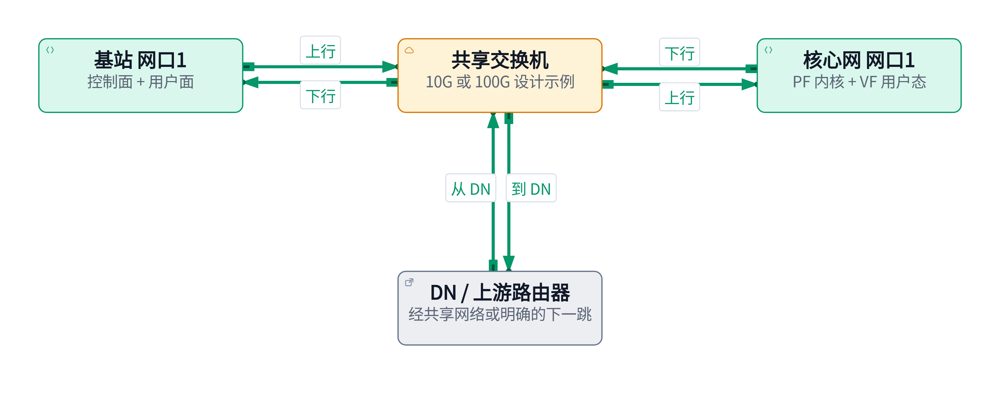

方式一：基站和核心网各用一个物理口接同一交换机。控制面可由 PF/Linux 承载，用户面由分配出的 VF/VPP 承载。两者共享链路容量及物理故障点；可以使用不同地址/VLAN，但不会获得额外物理带宽。

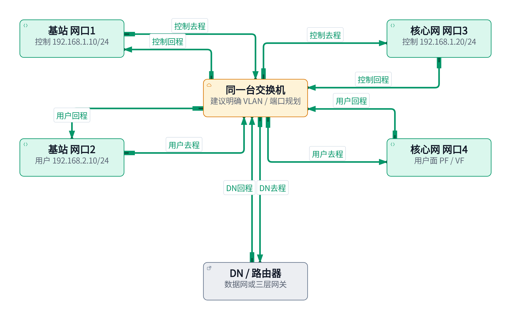

方式二：基站网口1 ↔ 核心网网口3 使用 `192.168.1.0/24`，承载控制面；基站网口2 ↔ 核心网网口4 使用 `192.168.2.0/24`，承载用户面。一个交换机内连接四个端口，并按需要划分 VLAN。只把 IP 配成两个网段，不会自动形成两个二层广播域。

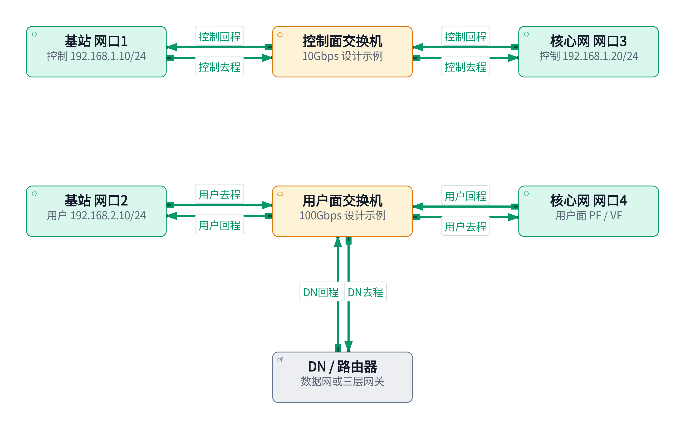

方式三：控制面通过独立 10G 交换机，用户面通过独立 100G 交换机。它隔离了两类流量的交换链路与故障域；每条路径仍是单链路，不能仅凭两台交换机就宣称具备冗余。

| 对比项 | 方式一 | 方式二 | 方式三 |
| --- | --- | --- | --- |
| 每端使用物理口 | 1 | 2 | 2 |
| 控制/用户面物理带宽 | 共享同口 | 不同口，但共用交换机 | 不同口、不同交换机 |
| 故障范围 | 网口/交换机故障影响两者 | 交换机故障仍影响两者 | 控制与用户链路故障较独立 |
| 适用解释 | 成本低、接线少 | 端口分离、便于资源规划 | 明确区分控制/高速用户网络 |

**DN 接在哪里？** 以上布线图只规定基站与核心网间的连接，还必须补上核心 DN/边缘 DN 接入。在本手册实验模型中，DN 服务器或其路由器接入用户面交换网络；核心网 N3、N6 可使用同一用户面 PF 的两个 VF，分别承担隧道侧和 DN 侧。基站的 N3 与边缘 DN 共用同一个用户面 VF，靠地址、路由和分流逻辑区分。若 DN 跨网段，必须配置可达的三层下一跳。

当前核心网 Chart 的两个 VF 来自同一个可配置资源名，不能假定只修改两个 IP 就能分别把 N3/N6 放到任意两个 PF。两池分配、VLAN 或端口映射需平台实际支持。本次文档说明能力和前提，不修改设备分配实现。

### 4.3 软件总览：控制面与两类用户面路径

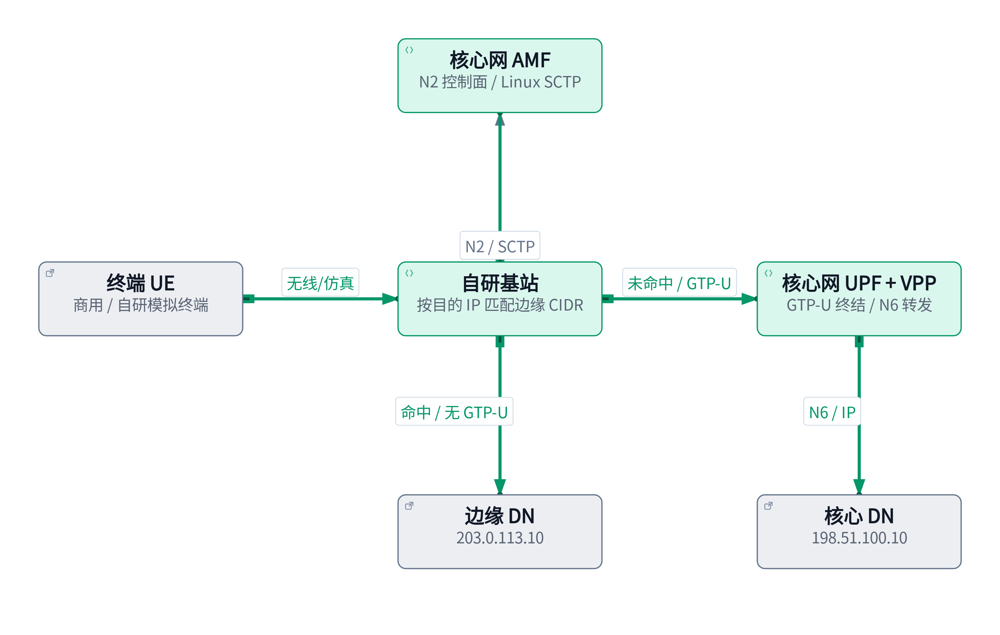

基站根据**业务报文的目的 IP**判断是否命中边缘 CIDR。未命中时进入 GTP-U/N3，经过核心网到核心 DN；命中时交给基站边缘转发路径，不加 GTP-U 头，直接与边缘 DN 交互。这是本次提供的自研扩展能力，不能归因于当前 OAI gNB，也不应直接等同于标准 UPF ULCL 实现。

边缘绕行是用户面路径选择；N2/SCTP 仍走 Linux 内核到 AMF。VPP 使用 VF 的用户态数据路径与内核控制路径并行。下行边缘报文还需根据 NAT 状态或路由和会话映射找到正确 UE；所给函数配置 VPP 接口与规则，并没有完整展示该分流/下行匹配调用链。

### 4.4 GTP-U 封装与 IP 变化要分开看

以 UE `10.45.0.2` 访问核心 DN `198.51.100.10` 为例：

```text
基站到 UPF 的 N3 报文（上行）
外层 Ethernet
  外层 IPv4：192.168.2.10 → 192.168.2.20
    UDP：目的端口 2152
      GTP-U：上行 TEID（会话隧道标识）
        内层 IPv4：10.45.0.2 → 198.51.100.10
          TCP/UDP：客户端端口 → 业务端口
```

加上外层 IP/UDP/GTP-U 不等于把 UE 内层 IP 改成基站 IP。UPF 解封装后仍得到 `10.45.0.2 → 198.51.100.10`；是否进一步改源 IP 取决于 N6 NAT。下行重新封装时，外层源/目的反向，但下行 TEID 由对应会话配置决定，不能假定与上行 TEID 相同。

GTP-U 还带来 MTU 开销。最基本的外层 IPv4 + UDP + GTP-U 为 20 + 8 + 8 字节，扩展头可继续增加；不能对所有 5G 报文固定减 36 字节后就认为安全。以实际路径 MTU、GTP 扩展和抓包结果为准。

### 4.5 当前核心网：TUN 与双 memif

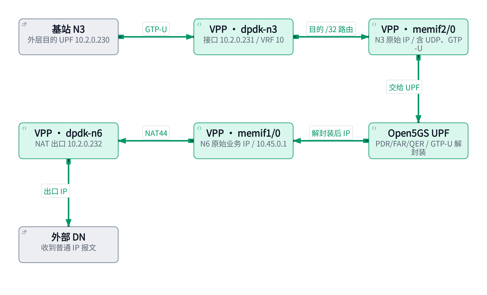

memif 是同主机进程间的共享内存报文接口；控制连接通常使用 Unix socket，数据经共享内存环传递。它不是物理网卡，也不是跨服务器的网络隧道。本项目 N3、N6 均使用 IP 模式，帧从 IP 头开始。

当前上行：`dpdk-n3 → memif2/0 → Open5GS UPF → memif1/0 → dpdk-n6`。VPP 的 N3 memif 传递的是**含 UDP/GTP-U 的外层 IP 报文**；N6 memif 传递的是**解封装后的业务 IP 报文**。UPF 承担 PFCP、PDR/FAR/QER/URR 与 GTP-U 语义，VPP 提供高速 I/O、路由和 N6 NAT。

| 当前真实配置（2026-10-25） | 地址 / 值 | 如何使用 |
| --- | --- | --- |
| AMF / 主机地址 | `10.2.0.119/20` | Linux N2/SCTP |
| UPF 对基站通告的 N3 地址 | `10.2.0.230` | gNB GTP-U 外层目的地址 |
| VPP dpdk-n3 | `10.2.0.231/20`，VRF 10 | 代理 ARP，并把 `.230/32` 路由到 memif2/0 |
| VPP memif2/0 | 借用 dpdk-n3 地址 | N3 共享内存 I/O |
| VPP memif1/0 | `10.45.0.1/16` | UE/N6 内层 IP，NAT inside |
| VPP dpdk-n6 | `10.2.0.232/20` | N6 出口，NAT outside / 地址池 |
| VPP N3/N6 网关 | `10.2.7.254` | 非直连目的的下一跳 |
| 模式 / NAT | `memif` / `true` | 当前实际运行模式 |

`.230` 与 `.231` 不可互换。代理 ARP 回应 `.230` 的邻居查询后，VPP 根据 `/32` 路由交给 memif，UPF 才是 GTP-U 终结者。N3 和 N6 各用一个 VF；两者可以同属一个 PF，也可以在具备相应资源配置时使用不同物理路径。

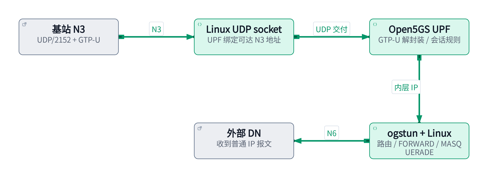

TUN 模式下 N3 使用 Linux UDP socket，UPF 解封装后写入 `ogstun`，随后由 Linux 路由、防火墙和 NAT 处理。下行反向进入 ogstun 后，由 UPF 匹配会话并封装。当前 Chart 的 TUN 初始化会创建 MASQUERADE；`vpp.n6.nat44.enabled=false` 只控制 VPP，不能用它关闭 TUN 的 Linux NAT。

当前主机仍能看到 `ogstun`，但其状态为 DOWN；**接口存在不证明它是当前业务路径**。以生效模式、容器、接口状态和计数综合判断。当前 Chart 拒绝 N3/N6 混搭成“UDP + memif”或“memif + TUN”。

### 4.6 场景一：终端 → 基站 → 核心网 → 核心 DN

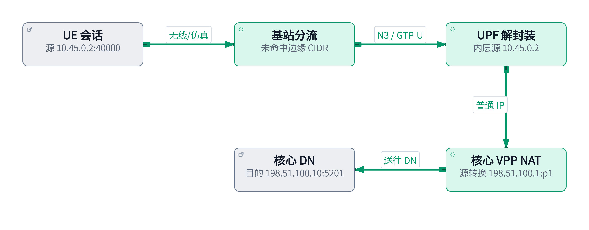

假设业务使用 TCP/5201，以下描述一条 UE 主动发起的连接。

| 观察点 | 上行报文 | 下行报文 |
| --- | --- | --- |
| UE 业务侧 | `10.45.0.2:40000 → 198.51.100.10:5201` | `198.51.100.10:5201 → 10.45.0.2:40000` |
| N3 隧道外层 | `192.168.2.10 → 192.168.2.20`，UDP/GTP-U | `192.168.2.20 → 192.168.2.10`，UDP/GTP-U |
| UPF 解封装 / N6 memif | 源仍是 `10.45.0.2:40000` | 逆 NAT 后目的为 `10.45.0.2:40000` |
| 核心 N6 外部口 | `198.51.100.1:p1 → 198.51.100.10:5201` | `198.51.100.10:5201 → 198.51.100.1:p1` |

动态 NAT 让核心 DN 看到 N6 出口地址，通常不需要 DN 为 UE 私网单独配置回程路由。回包到达 VPP 后先按状态逆转换，再交给 UPF 匹配会话、封装为下行 GTP-U。DN 看到出口 IP 不等于能够主动访问所有 UE。


关闭 N6 NAT 后，N3 封装流程不变，但 DN 看到的源为 `10.45.0.2:40000`；回复目的也直接是该 UE 地址。需要同时满足：

- DN 或上游路由器存在 `10.45.0.0/16 via 198.51.100.1`。
- VPP 将 UE 目的流量交给 N6 memif，UPF 中存在对应 PDU 会话和下行规则。
- 回程所经网络允许 UE 网段，邻居、ACL 和 MTU 均正常。

切换参数为 `vpp.n6.nat44.enabled=false`，完整离线渲染示例见附录 B。关闭 NAT 不会自动替 DN 配置路由。

### 4.7 场景二：终端 → 基站 → 边缘 DN

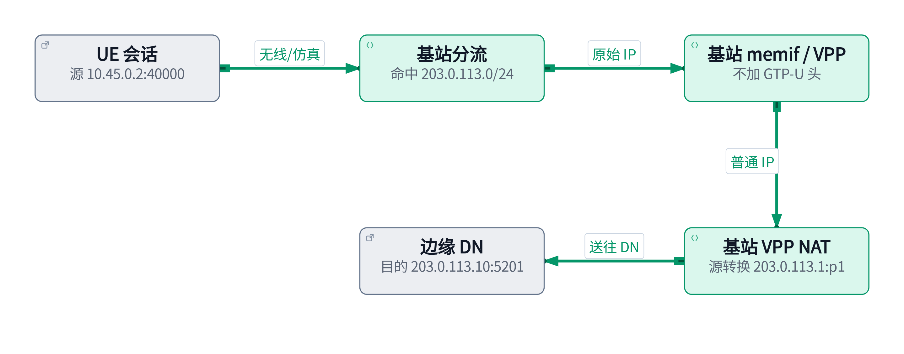

目的 `203.0.113.10` 命中边缘 `203.0.113.0/24`。基站不添加 GTP-U 头，将普通业务 IP 报文交给边缘 memif/VPP。`UspLbLinkVppMemifNat` 将该 memif 设为 NAT inside，公共出口设为 outside，并建立 tenant VRF 与地址池。

| 观察点 | 上行报文 | 下行报文 |
| --- | --- | --- |
| UE 到基站业务侧 | `10.45.0.2:40000 → 203.0.113.10:5201` | `203.0.113.10:5201 → 10.45.0.2:40000` |
| 基站边缘 memif | 普通 IP；无 N3 GTP-U 外层 | 逆 NAT 后的 UE 目的 IP |
| 基站 VF / 边缘 DN | `203.0.113.1:p1 → 203.0.113.10:5201` | `203.0.113.10:5201 → 203.0.113.1:p1` |

NAT 地址 `203.0.113.1` 必须可由 DN 返回到该基站 VPP。添加 NAT 地址池本身不保证外部 ARP、出口地址、下一跳或 VLAN 已正确配置；这些属于全局初始化和组网前提。

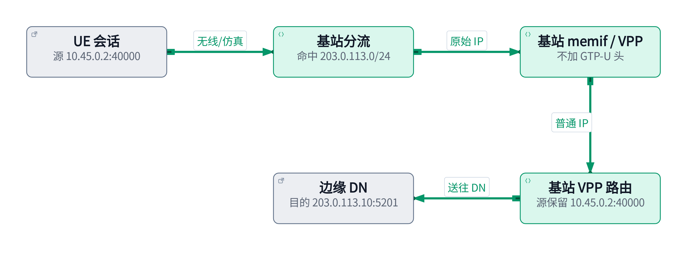

`UspLbLinkVppMemifRoute` 建立 IP 模式 memif、辅助地址与 `pInsideCidr via memif` 路由，不增加 NAT。DN 收到源 `10.45.0.2`，需将返回流量路由到基站边缘出口，例如 `10.45.0.0/16 via 203.0.113.1`。

基站还需要到边缘 DN 的可达路由，以及将下行 memif 报文送到 UE 的会话匹配。如果多个 memif 共享默认路由表，`pInsideCidr` 应能区分会话，例如各 UE 的 `/32` 或不重叠后方网段；不能给多个会话重复添加同一个宽泛前缀后假定流量自然分到正确 UE。

两个边缘函数均未展示全局 DPDK 出口初始化、NAT 插件启用、跨网段网关和会话分流代码。它们能说明配置意图，不能单独证明任意拓扑下都已双向可用。

### 4.8 终端类型与模拟 UE 的 memif

| 终端 | 用户业务进入终端协议栈的方式 | 课堂边界 |
| --- | --- | --- |
| 商用手机 / 商用终端 | 商用终端自身协议栈与无线接入 | 不假定它暴露 Linux TUN 或 VPP memif |
| 当前 OAI nrUE | `oaitun_ue1` 等 TUN 接口 | Linux 程序经 TUN 进入 UE 协议栈 |
| 自研模拟 UE · TUN | 类似 OAI UE 的 TUN 接入 | 以提供的说明为依据 |
| 自研模拟 UE · memif | 应用与 VPP 经共享内存交换 IP 报文 | 可接入 LAN / Wi-Fi 路由器 |

`UspLbLinkVppMemifSessionCreate` 中，`VRF = memifId + 100`。会话 loopback 配置 UE 的 `/32` 地址，memif 借用此地址，VRF 缺省路由指向 memif。`bLanFlag=true` 时，将 LAN 出口 `dpdk0` 加入该 VRF，并配置 `pLanIp/22`；`bNatFlag=true` 时，LAN 为 inside、memif 为 outside，将后方客户端源转换为 UE 会话 IP。

这里的 NAT **outside 是朝无线/仿真业务方向的 memif**，与核心网中“memif 是 inside”的角色不同。inside/outside 是相对某个 NAT 实例的边界，不能把所有 memif 一概称为 inside。

### 4.9 Wi-Fi 接法一：AP / 桥接


AP 关闭路由/NAT，按其产品要求将桥接口接入模拟 UE 的 LAN。设备取得 `192.168.40.10/22`，网关为模拟 UE `192.168.40.1`。地址可静态配置，或由单独安排的 DHCP 服务提供；所给 UE 函数只配置 VPP 接口/NAT，没有启动 DHCP 或 DNS 服务。

| 阶段 | 访问核心 DN 时的上行源 | 访问边缘 DN 时的上行源 |
| --- | --- | --- |
| 手机/电脑，经 AP 桥接 | `192.168.40.10:40000` | `192.168.40.10:40000` |
| 模拟 UE 的 LAN NAT 后 | `10.45.0.2:p1` | `10.45.0.2:p1` |
| 出口启用 NAT 后 | `198.51.100.1:p2` | `203.0.113.1:p2` |
| 出口为路由模式时 | 保持 `10.45.0.2:p1` | 保持 `10.45.0.2:p1` |

回包先通过核心/边缘出口的逆 NAT（若启用），再经模拟 UE 逆 NAT，最终到 `192.168.40.10:40000`。外部出口选择路由模式，并不意味着模拟 UE 的 LAN NAT 也被关闭。

### 4.10 Wi-Fi 接法二：WAN 路由 / NAT

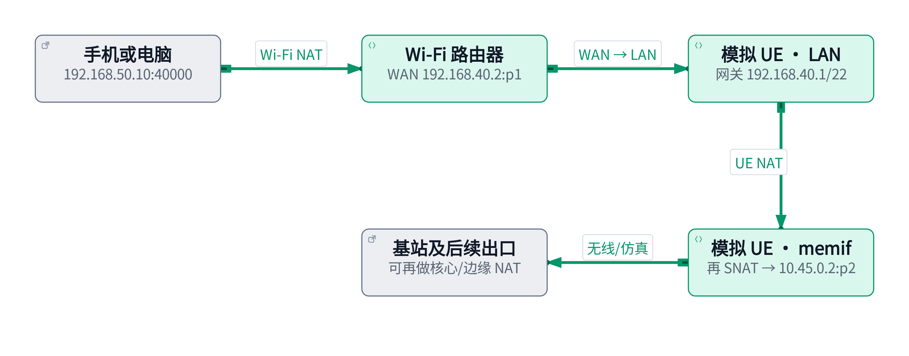

Wi-Fi 路由器 WAN 连接模拟 UE LAN：WAN 为 `192.168.40.2/22`，网关 `192.168.40.1`；Wi-Fi LAN 为 `192.168.50.0/24`，手机网关是 `192.168.50.1`。两侧网段不能重叠。

```text
访问核心 DN 198.51.100.10:5201（目的地址保持不变）
手机            192.168.50.10:40000
  → Wi-Fi NAT   192.168.40.2:p1
  → 模拟 UE NAT 10.45.0.2:p2
  → 核心 N6 NAT 198.51.100.1:p3
  → DN

回复按逆序还原目的：
198.51.100.1:p3 → 10.45.0.2:p2
  → 192.168.40.2:p1 → 192.168.50.10:40000
```

访问边缘 DN 时，把最后一级核心 N6 NAT 换为基站边缘 NAT；若该出口为静态路由，省略最后一级转换。每一级都需保有相应状态和正确回程。多级 NAT 会让“外部主动访问下游设备”和抓包关联更复杂。

### 4.11 想完全保留 LAN 源地址时，还缺什么

将 `bNatFlag=false` 只是不创建这层 UE NAT。完整的无 NAT 后方网络需要：模拟 UE 的 LAN 转发、基站的下行会话映射、核心网订阅/UPF 后路由匹配、VPP 到后方网段的路由、DN 回程路由，以及各处源地址检查均支持该网段。

本仓库已有 IPv4 后路由能力与历史验证记录，但那是特定 OAI RFsim 测试环境，不可直接当成自研 UE 的全面验收。尤其“订阅后路由”和“VPP FIB 路由”各自解决不同环节，不能互相替代。

同一个 `dpdk0` 被函数设置到某个 session VRF 后，不能同时属于多个其他 VRF。多会话共享一个 LAN 物理出口需要独立 VF/子接口或其他明确设计；所给函数本身没有展示这种复用方案。

**课堂练习**：手机经 Wi-Fi 路由器访问边缘 DN，UE NAT 开启、基站使用路由模式。DN 应看到什么源地址？答案是 UE 会话地址 `10.45.0.2`（端口可能已转换），不是 Wi-Fi 手机地址，也不是基站出口地址。

## 5. 性能测试

### 5.1 iperf2 与 iperf3 的区别

| 项目 | iperf / iperf2 | iperf3 |
| --- | --- | --- |
| 本机版本 | 2.1.5 | 3.9 |
| 默认服务端口 | 5001 | 5201 |
| 互通性 | 需要 iperf2 对端 | 需要 iperf3 对端，不能与 iperf2 混用 |
| UDP 服务端 | 通常使用 `iperf -s -u` | `iperf3 -s`，协议由客户端协商 |
| 反向 | 本机版本支持 `-R`，以 `--help` 为准 | `-R` |
| 双向 | `-d`、`-r`、`--full-duplex` 含义不同 | `--bidir`，检查版本支持 |
| 并行流 | `-P`，多线程实现 | 本机 3.9 不能靠 `-P` 获得 3.16 之后的每流线程机制 |
| 结构化结果 | 可按版本使用 CSV 等输出 | 常用 `-J` 输出 JSON |

iperf3 自 3.16 起为每条测试流创建独立线程，不能笼统地说“iperf3 永远单线程”，也不能把新版本行为套到本机 3.9。[iperf3 FAQ](https://software.es.net/iperf/faq.html)

TCP 测试观察可靠传输的有效吞吐、重传与拥塞表现；UDP 测试按设定速率发包，观察实际接收速率、丢包与抖动。UDP 的发送端显示 1G 不代表接收端收到 1G。

### 5.2 测试位置与反向灌包

本节默认：**客户端运行在 UE 业务侧或其下挂电脑，服务端运行在 DN**。正向数据为 UE → DN，即上行；反向数据为 DN → UE，即下行。`-R` 改变数据方向，客户端仍主动建立测试控制连接，不能据此证明 DN 可任意主动连接一个位于 NAT 后的服务。

服务端绑定的地址必须真实属于服务端所在的 Linux 协议栈。如果地址只属于 VPP loopback，Linux iperf 不能直接 `-B` 绑定它；自研 memif 场景可在下挂电脑运行 iperf，或通过已实现的主机协议栈接入方式测试。不能为方便测试凭空把 VPP 的 UE 地址再配到 Linux。

### 5.3 iperf3：TCP、UDP、正向与反向

执行位置：核心 DN 实验服务器。`[负载准备]`，前台运行，结束用 Ctrl+C。

```bash
iperf3 --version
iperf3 -s -B 198.51.100.10 -p 5201
```

执行位置：UE 业务侧 Linux 或下挂电脑。以下每条测试单独运行；DN 地址改为边缘 DN 后可测试边缘路径。`[负载]`。

```bash
DN_IP=198.51.100.10
# TCP 上行 / 下行；一次单流，再尝试四流
iperf3 -c "$DN_IP" -p 5201 -t 20 -i 1
iperf3 -c "$DN_IP" -p 5201 -t 20 -i 1 -R
iperf3 -c "$DN_IP" -p 5201 -t 20 -i 1 -P 4
# UDP 上行 / 下行：先 10Mbps，1200 字节载荷
iperf3 -c "$DN_IP" -p 5201 -u -b 10M -l 1200 -t 20 -i 1
iperf3 -c "$DN_IP" -p 5201 -u -b 10M -l 1200 -t 20 -i 1 -R
# 同时双向；不等于单独的反向测试
iperf3 -c "$DN_IP" -p 5201 -t 20 --bidir
# 保存机器可读结果
iperf3 -c "$DN_IP" -p 5201 -t 20 -J > /tmp/iperf3-ul.json
```

iperf3 的 UDP 测试仍需 TCP 控制连接；防火墙只开放 UDP/5201 不够。`-b` 与 `-P` 同时使用时，目标速率按每流计算，例如 `-P 4 -b 10M` 的合计目标约 40Mbps。[命令说明](https://software.es.net/iperf/invoking.html)

要限制 TCP 测试负载，可增加本机支持的 `-b 10M`；不加限制的 TCP 会尝试利用可用带宽。先完成低速连通性验证，再按测试窗口逐级增加速率。

### 5.4 iperf2：TCP、UDP、正向与反向

TCP 服务端执行 `iperf -s -B 198.51.100.10 -p 5001`；停止后，UDP 服务端改为 `iperf -s -u -B 198.51.100.10 -p 5001`。客户端与服务端都使用 iperf2。

执行位置：UE 业务侧 Linux 或下挂电脑，`[负载]`。

```bash
DN_IP=198.51.100.10
# TCP，配合 TCP 服务端
iperf -c "$DN_IP" -p 5001 -t 20 -i 1
iperf -c "$DN_IP" -p 5001 -t 20 -i 1 -R
iperf -c "$DN_IP" -p 5001 -t 20 -i 1 -P 4
# UDP，配合 UDP 服务端
iperf -c "$DN_IP" -p 5001 -u -b 10M -l 1200 -t 20 -i 1
iperf -c "$DN_IP" -p 5001 -u -b 10M -l 1200 -t 20 -i 1 -R
# 双向示例（TCP 服务端）
iperf -c "$DN_IP" -p 5001 -t 20 --full-duplex
```

本机 `iperf --help` 已列出 `-R`。对旧版 iperf2，不要假定一定支持；双方核对版本。`-d` 是同时双向但使用额外反向连接，`-r` 是先后双向，也会涉及反连；这些方式可能被 NAT/防火墙阻断，不能直接替代 NAT 场景下的 `-R`。`--full-duplex` 在本机帮助中描述为同 socket 全双工测试，仍需双端版本支持。

### 5.5 如何判断瓶颈

| 观察现象 | 优先核对 | 进一步取证 |
| --- | --- | --- |
| 两端无法建连 | 路由、监听地址、TCP/UDP 端口、防火墙 | ss、route get、端到端抓包 |
| UDP sender 高、receiver 低 | 丢包、队列、接收 CPU、QoS | 两端统计、VPP error/drop、VF 计数 |
| TCP 多流明显高于单流 | 单流 CPU、RTT/窗口、拥塞、RSS 分布 | CPU 与重传；不能直接认定网络线速不足 |
| 只在反向低速 | 下行路由、NAT 状态、下行 QER、接收端 | 在 N6、N3 两侧比较计数 |
| CPU 未满但 VPP 抖动 | quota throttling、线程迁移、NUMA、SMT | cgroup cpu.stat、线程亲和性、调度延迟 |
| 接近固定速率上限 | 链路协商、订阅 AMBR/QER、整形策略 | 网卡 Speed 与实际生效 QoS 配置 |

一次测试至少记录：日期、端点与位置、两端工具版本、路径/模式、TCP 或 UDP、方向、流数、目标速率、包长/MTU、持续时间、接收吞吐、丢包/重传及 CPU。测试结果只代表该路径与配置；OAI RFsim 结果不是商用空口或 100G 硬件验收结果。

## 6. Kuboard 与 k9s

### 6.1 两种界面，一套 Kubernetes 对象

Kuboard 是 Web 管理界面，适合浏览资源和团队协作；k9s 是终端交互界面，适合在 SSH 环境快速切换资源、日志和事件。二者都是 Kubernetes 的客户端，最终操作受集群身份和 RBAC 约束，界面可见性不代表具备全部权限。[Kuboard 简介](https://kuboard.cn/overview/)

本次未在当前节点的 Kubernetes Pod 或 Docker 容器中发现 Kuboard 运行实例，因此以下以 Kuboard v3 常用工作流为说明，不虚构本机登录地址或操作截图。已有 k9s 版本为 `v0.51.0`。

### 6.2 Kuboard 的常用工作流

1. 使用管理员提供的入口和个人账号登录，确认目标集群。
2. 进入目标 Namespace，例如 `xcn`；先查看工作负载、副本、Pod 状态和事件。
3. 打开 `xcn-5gc` 对应 Pod，选择 `upf` 或 `vpp` 容器查看日志；多容器日志不要混看。
4. 查看工作负载 YAML、资源 requests/limits、环境变量来源、卷挂载和关联 Service。
5. 结合 Events 判断调度、挂载和探针失败；根据时间关联容器日志。
6. 需要终端、重启、编辑或删除时，先明确影响对象。Helm 管理的资源应把变更落实回 Chart/values，避免下次发布覆盖界面上的临时修改。

具体菜单名随版本和部署方式变化，以实际界面为准。导入集群或创建凭据属于管理员工作；课件不分发 kubeconfig、ServiceAccount token 或集群管理员账号。

### 6.3 k9s 的启动和快捷键

执行位置：有 kubeconfig 的服务器 Shell。课堂建议先以只读方式进入。

```bash
k9s version
k9s --help
k9s -n xcn --readonly
# 使用指定 context，名字通过 kubectl config get-contexts 查询
kubectl config get-contexts
# k9s --context YOUR_CONTEXT -n xcn --readonly
```

| 按键 / 命令 | 用途 | 操作提示 |
| --- | --- | --- |
| `?` | 当前视图帮助 | 以当前版本和视图提示为准 |
| `:ns` / `:ctx` | Namespace / context 视图 | 切换后重新确认目标 |
| `:pods` / `:deploy` / `:svc` | 查看 Pod / Deployment / Service | 支持资源别名 |
| `:events` / `:nodes` | 事件 / 节点 | 排查 Pending、探针和资源问题 |
| `/关键词` | 过滤当前列表 | Escape 退出过滤或返回 |
| `d` / `y` / `l` | Describe / YAML / 日志 | 在对应资源视图操作 |
| Enter | 进入选中对象 | Pod 常可继续选择容器 |
| `:q` / Ctrl+C | 退出 | 不影响业务容器运行 |

快捷键受视图和配置影响，先按 `?`。只读模式禁用修改操作；实际权限仍由 RBAC 控制。非只读模式中的编辑、删除、重启等操作会修改集群，应与命令行变更一样审慎。[k9s 命令参考](https://k9scli.io/topics/commands/)

### 6.4 十分钟练习

使用 k9s 进入 `xcn`，找到 `xcn-5gc`，查看 Events、UPF 日志、YAML 中的 CPU/VF 请求；再用 kubectl 完成同样查询。用 Kuboard 时寻找同一组对象和字段。练习目标是理解对象关系，不是记住某一版界面的按钮位置。

若显示“无资源”，依次检查 context、Namespace、过滤条件和 RBAC；若日志为空，检查容器选择、重启历史以及应用是否输出到文件而非 stdout。

## 附录 A：命令速查与分层排障

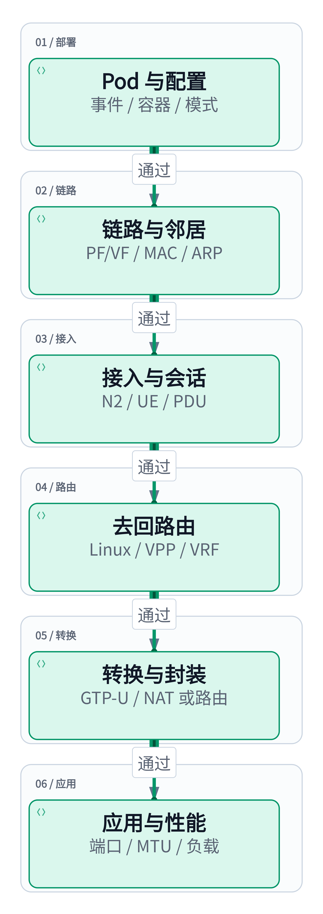

任一步不通过时，先留在该层定位，修复后复验；不要从“网页打不开”直接跳到“换 VF/调大核数”。

| 现象 | 第一组检查 | 常见原因与下一步 |
| --- | --- | --- |
| Pod Pending | `kubectl describe pod`、节点资源 | CPU/内存/大页/VF 不足、节点选择不匹配 |
| ImagePullBackOff | Pod Events、`crictl images` | 名称/tag、认证、CA、节点 DNS/代理 |
| CrashLoopBackOff | 当前与 `--previous` 日志 | 配置错误、绑定地址错误、启动依赖、memif socket |
| Pod Running 但未 Ready | Readiness、容器状态 | Running 不等于业务初始化完成 |
| N2 不通 | SCTP 监听、AMF 地址、路由、日志 | 防火墙/SCTP、地址或 PLMN 配置 |
| UE 有 IP 但业务不通 | PDU、N3 地址/TEID、PDR/FAR、路由 | 会话存在不保证数据面可达 |
| VF 分配成功但无 RX | PF 链路、VF MAC/VLAN、邻居 | 线缆/交换机、VF 状态、错绑 PCI |
| 只有单向通 | 回程路由、NAT 状态、rp_filter | DN 不知道 UE 网段、状态不匹配、非对称路由 |
| 边缘流量仍进核心网 | 实际业务目的 IP、CIDR 配置 | DNS 解析到其他网段、规则未生效 |
| 小包通，大包卡住 | MTU、ICMP、MSS、分片 | GTP-U 开销、PMTUD 被阻断 |
| DN 看不到手机私网地址 | 列出各层 NAT | AP、Wi-Fi NAT、UE NAT、出口 NAT 分别确认 |
| Ping 近乎零延迟但应用不通 | 观察真实路径和 TCP/UDP 报文 | 可能由本地/代理端回应，不能只据 ping 判断端到端通过 |
| CPU 看似有余量但吞吐低 | SMT/NUMA、quota、丢包、QoS | 线程或单流瓶颈，不只看全机平均利用率 |

### A.1 当前环境的最短查询清单

```bash
kubectl get nodes -o wide
kubectl -n xcn get pods -o wide
kubectl -n xcn get events --sort-by=.metadata.creationTimestamp
kubectl -n xcn exec deploy/xcn-5gc -c upf -- xcnctl show ue
kubectl -n xcn exec deploy/xcn-5gc -c upf -- xcnctl show gnb
kubectl -n xcn exec deploy/xcn-5gc -c vpp -- vppctl show memif
kubectl -n xcn exec deploy/xcn-5gc -c vpp -- vppctl show interface address
kubectl -n xcn exec deploy/xcn-5gc -c vpp -- vppctl show ip fib table 10
kubectl -n xcn exec deploy/xcn-5gc -c vpp -- vppctl show nat44 interfaces
kubectl -n xcn exec deploy/xcn-5gc -c vpp -- vppctl show errors
```

### A.2 代理与 Clash 相关排查

镜像下载、容器出网或 DN TCP 异常时，分别检查 Shell 显式代理、Docker/containerd 服务代理、主机透明代理规则及目标路由。它们可能不是同一套配置。

```bash
# [查询] 先确认命令是否存在；具体子命令以本机帮助为准
command -v clashctl
clashctl --help
ip rule show
ip route show table all
sudo iptables-save | grep -E 'CLASH|OUTLINE|REDIRECT|TPROXY'
sudo nft list ruleset
```

查询代理环境变量或服务配置时，输出可能含账号，应先在本地查看并脱敏。透明代理可能重定向 TCP，却不影响 ICMP，表现为 ping 正常、应用连接异常。必要时为实验业务网段配置精确直连例外，并记录原规则和恢复方法；不要直接清空防火墙或全局关闭代理。

构建阶段可按环境使用 `docker build --network host`；实验容器也可按需要使用主机网络。但 host 网络不会自动绕过透明代理，还会共享主机端口空间。仓库历史后路由验证中曾遇到 DN 的透明代理重定向，因此应结合实际规则与抓包判断。

### A.3 常见术语速查

| 缩写 | 含义 | 与本课程的关系 |
| --- | --- | --- |
| NFVI / CNF | 网络功能虚拟化基础设施 / 云原生网络功能 | 平台与容器化业务 |
| PF / VF / SR-IOV | 物理功能 / 虚拟功能 / 单根 I/O 虚拟化 | 网卡资源划分 |
| CNI / CRI | 容器网络接口 / 容器运行时接口 | 网络插件与运行时调用边界 |
| NUMA / SMT | 非一致内存访问 / 同时多线程 | CPU、内存与性能 |
| VRF / FIB | 独立路由域 / 转发表 | 相同 IP 可处于不同查表上下文 |
| DPDK / VPP / memif | 用户态报文 I/O 工具库 / 报文处理平台 / 共享内存接口 | 高速数据路径 |
| PDU / DNN | 协议数据单元 / 数据网络名称 | 会话与数据网络选择 |
| TEID / GTP-U | 隧道端点标识 / 用户面隧道协议 | N3 封装与会话识别 |
| PDR / FAR / QER / URR | 检测 / 转发 / QoS / 用量规则 | UPF 用户面行为 |
| MTU / MSS / PPS | 最大传输单元 / TCP 最大分段 / 每秒包数 | 报文大小和性能指标 |

## 附录 B：核心网与 OAI 部署示例

### B.1 三种核心网配置的离线检查

在 Open5GS 仓库根目录执行。以下仅 `helm template` 输出文件，不安装或切换当前集群。硬件、地址和实验授权准备好后，才把对应参数用于发布。

```bash
# TUN：N3 使用主机地址，不需要 VF
helm template training ./helm/xcn -n training \
  --set fivegc.hostNetwork.enabled=true \
  --set networking.amf.ngap.serverAddress=192.168.1.20 \
  --set networking.upf.mode=tun \
  --set networking.upf.n3.address=192.168.2.20 \
  > /tmp/training-tun.yaml

# memif + NAT：N3 UPF 地址与 VPP N3 接口地址分别设置
helm template training ./helm/xcn -n training \
  --set fivegc.hostNetwork.enabled=true \
  --set networking.amf.ngap.serverAddress=192.168.1.20 \
  --set networking.upf.mode=memif \
  --set networking.upf.n3.address=192.168.2.20 \
  --set vpp.n3.interfaceAddress=192.168.2.21/24 \
  --set vpp.n6.externalAddress=198.51.100.1/24 \
  --set vpp.sriov.resourceName=intel.com/external_network \
  --set vpp.sriov.deviceEnv=PCIDEVICE_INTEL_COM_EXTERNAL_NETWORK \
  --set vpp.n6.nat44.enabled=true \
  > /tmp/training-memif-nat.yaml

# 使用同样的 memif 参数，将 nat44.enabled 改为 false
# 即得到路由模式；仍需 DN 回程路由，不能只改此开关。
```

这里 N3 与 DN 为直连教学网段，因此不填默认网关；非直连时设置 `vpp.n3.defaultGateway`、`vpp.n6.defaultGateway` 为对应网络真实可达的下一跳。TUN 地址应存在于内核接口；memif 的 UPF/VPP 数据面地址应由 VPP 路径承载，避免把相同地址同时设成 Linux 本地地址而截获流量。

### B.2 安装、验证和卸载的对应关系

实验安装形式为 `helm upgrade --install xcn ./helm/xcn -n xcn --create-namespace -f LAB_VALUES.yaml`。`LAB_VALUES.yaml` 必须完整记录本实验地址、模式、资源和镜像。先保存 `helm get values` 与 `helm history`，再安排可能引起会话重建的发布窗口；回滚清单后 UE 也可能需要重新建立会话。

OAI gNB / nrUE Chart 在相邻仓库。以下是用户环境的部署形式，仅在对应实验未占用且配置已核对时执行：

```bash
# [实验变更] 本机参考 AMF 地址；需与 gNB 的其他配置一致
helm install gnb /home/xiazhangtao/code/openairinterface5g/charts/oai-gnb \
  --set amf.ip=10.2.0.119
helm install nrue /home/xiazhangtao/code/openairinterface5g/charts/oai-nr-ue
# 完成实验后卸载本次创建的 Release
helm uninstall nrue
helm uninstall gnb
helm uninstall xcn -n xcn
```

当前运行中的 nrUE Release 不止一个，实际名称以 `helm list -A` 为准。不要为了试命令而卸载已有业务。gNB/UE 注册还需 PLMN、TAC、切片、DNN、订阅鉴权及无线/仿真参数匹配；仅设置 AMF IP 不能保证接入成功。

## 附录 C：三个自研函数的实现说明

### C.1 基站边缘动态 NAT：UspLbLinkVppMemifNat

| 配置步骤 | 函数中的意图 | 必须成立的条件 |
| --- | --- | --- |
| `VRF = memifId + 1` | 每条 memif 使用独立路由表 | 本函数要求 VRF ≤ 254，因此 memifId ≤ 253 |
| `memif0/id`，IP 模式 | 接收基站应用交付的普通 IP | socket 及对端连接正确，ring/队列匹配 |
| `10.255.VRF.1/32` | memif 辅助地址 | 不是 DN 看到的 NAT 地址 |
| target CIDR → OUT_IF | 在租户 VRF 为边缘目标选出口 | `via 接口` 依赖可用的邻接/直连或额外转发安排 |
| inside CIDR → memif | 为内部目的建立返回方向路由 | CIDR 与实际 UE/后方地址匹配 |
| memif in / OUT_IF out | 指定 NAT 两侧 | NAT 插件与外部 VRF 查表前提已初始化 |
| NAT IP + tenant-vrf | 分配该租户的转换地址 | DN 能路由/解析到 NAT 地址，外部返回命中正确状态 |

向以太网出口只指定 `via 接口`，不能自动让远端网段通过任意网关可达。实际非直连拓扑必须核对下一跳、邻居解析和租户/外部 VRF 的查表行为。

### C.2 基站边缘路由：UspLbLinkVppMemifRoute

创建 `memif0/id`，配置 `10.255.(id+1).1/32` 并置 UP，然后添加 `pInsideCidr via memif`。函数未显式新建/绑定 VRF，按全局默认表环境理解；未建立 NAT，也没有配置到边缘 DN 的完整出口路由。

所给代码不像 NAT 函数一样检查 `id+1 ≤ 254`，也未展示 `pInsideCidr` 校验。培训示例采用合法小编号；不应由此推断所有 UINT16 编号都可组成合法 IPv4 地址。多会话前缀重叠也需要额外设计。

### C.3 模拟 UE：UspLbLinkVppMemifSessionCreate

| 对象 | 配置 | 作用 |
| --- | --- | --- |
| session VRF | `memifId + 100` | 分离会话路由上下文；当前函数约束 memifId ≤ 154 |
| loopback | UE IP `/32`，属于该 VRF | 代表会话业务地址 |
| memif | 同 VRF，借用 loopback 地址 | 连接模拟 UE 应用，不再分配另一业务 IP |
| default route | `0/0 via memif` | 将 LAN 上行交给 UE 协议栈 |
| dpdk0 | `pLanIp/22`，加入 session VRF | LAN 入口；固定 /22 是当前函数行为 |
| NAT | dpdk0 in、memif out、地址池为 UE IP | 把 LAN 源转换成 UE 会话地址 |

`bLanFlag=false` 时不配置 LAN；`bNatFlag` 只在 LAN 分支内生效。`bLanFlag=true, bNatFlag=false` 需要全链路后路由支持。所给代码验证了 UE IPv4，但未展示等价的 LAN IP 完整校验。

### C.4 如何理解“函数返回成功”

三个函数都先查询 memif，若输出中找到接口名便返回成功。它们没有逐项核对地址、VRF、路由、NAT 是否仍与本次入参一致；字符串子串匹配也不能替代精确接口标识检查。中间命令失败后可能留下部分对象，代码片段未展示事务回滚或并发串行化机制。

因此“RET_OK”不等于“配置已更新”“接口对端已连接”或“数据双向可通”。验证应查看精确接口、memif 连接状态、FIB、NAT 与真实业务报文。多线程同时配置同一接口的行为、失败清理和删除会话逻辑，需结合未提供的完整实现审查。本培训只解释这些边界，不修改自研代码。

VPP CLI 拼写也需匹配实际版本，例如本仓库 VPP 26.06 模板使用 `set interface unnumbered ... use ...`；不能把代码片段中所有 CLI 字符串都直接认定为当前镜像已验证的语法。

## 附录 D：资料来源与验证边界

### D.1 本地实现依据

本次仓库基线：`4ccc714f5f7b39e685c39a9637e2497705ab2d19`。实际生成与验证记录见同目录 `VALIDATION.md`。

| 来源 | 支撑内容 |
| --- | --- |
| `helm/xcn/values.yaml`、`templates/_helpers.tpl` | 参数、模式派生、CPU/队列与 VF 配置 |
| `helm/xcn/templates/config.yaml`、`templates/5gc.yaml` | memif、FIB、代理 ARP、NAT、容器资源 |
| `helm/xcn/files/vpp-entrypoint-dual.py` | PCI 读取、cpuset 等待、VPP 线程配置 |
| `src/upf/gtp-path.c`、`n3-memif.c`、`n6-memif.c` | GTP-U 与 N3/N6 报文收发职责 |
| `docker/runtime/setup.sh` | TUN、Linux 转发和 MASQUERADE 初始化 |
| `docs/framed-routes-live-validation.md` | 特定历史后路由测试与透明代理/MTU问题 |
| 本次用户提供的三个 UspLbLink 函数和说明 | 自研基站边缘分流、模拟 UE LAN/memif 配置意图 |

历史 README 中部分默认核数和 worker 描述存在旧值；本手册以当前 values、渲染清单和运行态为准。静态阅读和离线渲染不等于完成模式切换、商用终端或自研基站实测。

### D.2 官方参考与版本使用原则

- [Kubernetes 组件](https://kubernetes.io/docs/concepts/overview/components/)与[设备插件](https://kubernetes.io/docs/concepts/extend-kubernetes/compute-storage-net/device-plugins/)：对照本机 1.26.8，避免照搬新版特性。
- [Docker 镜像](https://docs.docker.com/get-started/docker-concepts/the-basics/what-is-an-image/)与[Harbor 推拉](https://goharbor.io/docs/2.14.0/working-with-projects/working-with-images/pulling-pushing-images/)：不同运行时分别检查认证与 CA。
- [Helm upgrade](https://helm.sh/docs/helm/helm_upgrade/)：官网可能默认新版；本文示例按本机 Helm 3.17.3 帮助和实际渲染核对。
- [SR-IOV Device Plugin](https://github.com/k8snetworkplumbingwg/sriov-network-device-plugin)：资源发布、PCI 设备与 CNI 的分工。
- [Linux IP sysctl](https://docs.kernel.org/networking/ip-sysctl.html)：转发及反向路径检查。
- [iperf3 使用说明](https://software.es.net/iperf/invoking.html)与[FAQ](https://software.es.net/iperf/faq.html)：以双方已安装版本为准；iperf2 参数另以本机 `iperf --help` 为准。
- [Kuboard](https://kuboard.cn/overview/)与[k9s](https://k9scli.io/topics/commands/)：实际菜单和快捷键以目标版本为准。
- VPP 接口和路由查询命令依据当前运行的 `v26.06-release` CLI 帮助与本仓库部署模板核对。

本手册将服务器查询快照、仓库实现、用户提供实现、教学示例及历史实验分别注明。未切换生产网络进行本轮端到端性能验收；没有为 10G/100G 拓扑编造吞吐结果。分发前可刷新查询快照，尤其是 Pod 名、版本、地址和资源分配。
