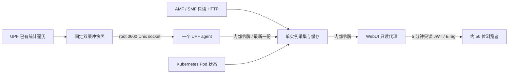

# WebUI 核心网监控

管理员的专载管理、会话释放与用户释放见 [WebUI 会话与用户控制](webui-core-control.md)。显式控制操作使用独立路由和有界审计，不改变监控轮询的数据路径。

NGAP ASN.1 / NAS 协议树、码流、容量限制和启用流程见 [WebUI 信令详情](webui-signaling.md)。该扩展默认关闭，需独立性能验收后在维护窗口启用。

监控采用单实例定时采集、独立进程内存缓存和 WebUI 只读接口。浏览器不会调用 `xcnctl`，也不会直接查询 AMF、SMF 或 UPF。事件按容量保留，无 30 分钟过期规则；速率曲线使用固定点数的环形缓存。

Chart 默认 `monitor.enabled: false`。2026-10-23 应用户明确要求，现场 `xcn` 已升级并启用监控演示，接入真实 OAI UE 并保持限速双向流量，见本文末尾记录。第一次启用会给 5gc Pod 增加 sidecar 和共享 socket 卷，触发 Pod 重建，需安排维护窗口；正式性能验收要求见下文。

## 数据路径



监控数据不写 MongoDB。MongoDB 仍用于原有订阅、模板、账户和登录；监控轮询路由在 session 中间件之前处理，不在每次轮询时访问会话数据库。登录后每 4 分钟更新一次监控令牌，原有管理 API 不能使用该令牌。

| 数据 | 周期 | 行为 |
| --- | --- | --- |
| AMF、SMF 事件 | 2 秒 | 每轮每网元最多 2 页，每页 1,000 条；按 boot_id / seq 去重和追踪缺口 |
| UPF 速率与规则 | 2 秒 | 一个 agent 读取，单批最多 4 MiB；不排队，不接受截断或超过 6 秒的快照 |
| UE、PDU 详情 | 10 秒 | 每页最多 100 条，完整批次最多 4,096 条、8 MiB；部分失败不覆盖上一份完整结果 |
| gNB | 15 秒 | 同一网元串行调度，避免多个任务同时查询 |
| 容器状态 | 30 秒 | 仅读取本 namespace Pod 的就绪状态与重启次数 |

周期可调慢，不能通过配置低于表中下限。失败采用退避，跳过错过的周期，不补发积压请求。浏览器约 2 秒刷新，有抖动、取消和 ETag；切到后台停止刷新。

页面包括概览、终端、基站、会话、事件和状态，支持浅色/深色主题、搜索、分页、详情和关联跳转。事件按协议筛选，默认 NGAP，可显示全部协议；事件与概览中的活动均为单行、毫秒时间。位置区分当前连接与最后已知位置，gNB 匹配包含 PLMN、ID 和位数，SEID 与累计计数以十进制字符串传递，避免 JavaScript 的 64 位精度丢失。

当前界面不依赖 Metrics Server，不再查询 Metrics API 或轮询未展示的 AMF/SMF/UPF 原始指标。状态页保留实际采集器内存、水位保护状态、数据源更新时间，以及 Pod/容器就绪状态和重启次数；缓存容量、底层锁计时和绑核详情保留在内部诊断数据中。

## 内存与保留策略

**30 分钟只描述默认速率趋势窗口，不是事件的有效期。**

| 对象 | 容量 |
| --- | --- |
| 事件 | 最多 20,000 条，且编码后的总长度最多 16 MiB；无时间淘汰 |
| 曲线 | 全局、用户、会话合计最多 512 条；每条固定 900 点，每点 3 个 double，原始数组合计约 10.55 MiB |
| Python 查询响应缓存 | 最多 128 项、8 MiB；大于 1 MiB 的响应不进入缓存 |
| WebUI 响应缓存 | 最多 64 项、16 MiB，1 秒有效期；相同在途请求合并 |
| WebUI 在途响应 | 最多 32 个不同请求；单响应最多 4 MiB，所有接收缓冲合计最多 16 MiB |
| UPF 快照 | 两份预分配数组，最多 4,096 会话 / 65,536 条规则，约 10 MiB；另有单份最多 4 MiB 的序列化响应 |

事件超限时按事件时间淘汰最旧记录；跨网元时间偏差可能影响此顺序。事件页和系统页显示实际起止时间及淘汰数量。低事件量时可以保留多天；缓存进程重启后，从网元仍存的环形缓冲重新读取，无法恢复已经被网元覆盖的事件。网元重启后保留已采集的旧 boot_id 事件，再从新序号起点增量读取。

编码字节数不等于 Python 进程内存。采集器还读取 cgroup v1/v2 实际内存用量、进程 RSS 和内存限制，采用实际限制与 `MONITOR_MEMORY_LIMIT_BYTES` 中较小值。Helm 通过 Downward API 注入容器 `limits.memory`。

- 保护水位为限额的 70%，恢复水位为 55%。默认 512 MiB 对应约 358.4 / 281.6 MiB。
- 读取 JSON 前检查原始大小，并保守预留最多该大小 32 倍的解析与派生开销；复制快照和生成查询结果前再次检查。
- 达到水位时清空查询缓存、减少事件到最多 1,000 条、丢弃用户和会话曲线，尽力归还分配器空闲页；保留全局曲线和最新完整快照。仍不足时拒绝新批次，暂停采集，详情查询返回 503；概览、健康与系统状态仍可查看。
- 降到恢复水位后自动允许采集。若最新状态本身已超出预算，需增加独立采集容器限额或降低详情规模；不能依赖历史淘汰解决无限规模的数据。

内存水位和预算为提前降载机制，不能把它解释为数学上保证永不 OOM。并发临时对象、运行库和分配器仍需余量；容器硬限额是最后一道边界。采集器独立于核心网进程，即使重启也不构成 UPF 转发的服务依赖。不要把采集器合并进 UPF 进程或 5gc 容器。

## UPF 与 CPU 隔离

UPF 监控默认关闭，仅设置 `XCN_UPF_MONITOR_SNAPSHOT=1` 才分配快照和创建查询线程。不开启时沿用原统计及 CLI 单线程路径。可选快照分配或查询线程创建失败会回退到旧路径。

新快照借用已有统计线程及其已有的规则读锁遍历，复制有界标量，不保留 session 指针；不增加包处理路径的锁、分配或序列化。固定双缓冲使用原子所有权，缓冲被占用就跳过。JSON、地址格式化和 socket I/O 都在规则锁外进行。旧 CLI 与统计线程共享的速率字段由专用 mutex 保护，采样端只 trylock，不等待；转发线程不使用此 mutex。统计和 socket 线程沿用现有控制线程绑核规则。

这会略微延长原有统计读锁持有时间，仍需测量控制面写入与高负载转发的影响，不能据此宣称“零性能影响”。socket 客户端读写有超时，关闭客户端不会因 SIGPIPE 结束 UPF。停止 agent 后订阅 6 秒到期，停止快照复制。

`monitor.cpuSet` 必须指定预留 CPU，供采集器、agent 和 WebUI 使用。不得与 UPF/VPP 的工作核、控制核及其 SMT 兄弟重叠。采集器读取实际 `xnet.com/used-core` 注解再验证，未能验证时停止 NF 采集；后续 Pod 分配变化也会重新验证。该实现不替运维系统预留 CPU，请同时确保这些核不被其他繁忙任务使用。

监控和 WebUI 默认 CPU 上限为 `900m`、内存上限为 `512Mi`。现场 xnet CPU webhook 会把整数核上限自动分配到独占 CPU，即使 request 是小数核，也会与手动指定的共享空闲核冲突；使用小数核上限后，再由 `monitor.cpuSet` 绑定已核验的空闲 CPU。不要将上限改为整数核而不重新核对实际分配。

```bash
lscpu -e=CPU,CORE,SOCKET,ONLINE
kubectl -n xcn get pods -o wide
kubectl -n xcn get pods -o json | python3 -c '
import json,sys
for p in json.load(sys.stdin)["items"]:
    print(p["metadata"]["name"], p["metadata"].get("annotations",{}).get("xnet.com/used-core", "无分配注解"))'
```

本地实验专用 `MONITOR_REQUIRE_AFFINITY=0` 不出现在 Helm 清单中，不可用于生产绕过核验。CPU 注解、Metrics API 或容器状态缺失都不应伪造为正常值。

## 构建、启用和停止

镜像构建在开发/构建主机执行；不要在正在承载业务的转发 CPU 上构建。UPF 运行镜像构建流程沿用项目现有 `docker/runtime/Dockerfile`，需要包含本次 `rate-snapshot` 改动。WebUI 和采集镜像如下，标签使用实际提交版本：

```bash
docker build --network host -f monitor/Dockerfile -t localhost:5000/xcn-monitor:YOUR_TAG .
docker build --network host -f docker/webui/Dockerfile -t localhost:5000/xcn-webui:YOUR_TAG .
```

有 Clash/代理时先验证构建网络。主机回环代理用于 `--network host` 构建的 RUN 阶段时，可显式传入 `--build-arg HTTP_PROXY=http://127.0.0.1:7890 --build-arg HTTPS_PROXY=http://127.0.0.1:7890`；镜像不持久化这些构建参数。Docker 守护进程拉取基础镜像使用独立网络设置，`--network host` 不会修复该阶段。不要为此重启生产 Docker 或全局更改代理。

启用前保存实际 release 值和回滚 revision，检查镜像可拉取，并选择已预留 CPU；不要把文档示例 CPU 号当作生产分配。生成覆盖文件后先 `helm diff`（若已安装）或 `helm template` 检查差异，重点查看 5gc Pod、原 UPF/VPP 配置和现有资源限额。

```bash
helm get values xcn -n xcn -o yaml > /tmp/xcn-before-monitor-values.yaml
helm history xcn -n xcn
cat > /tmp/xcn-monitor-values.yaml <<'YAML'
monitor:
  enabled: true
  cpuSet: "REPLACE_WITH_RESERVED_CPUS"
  image:
    repository: localhost:5000/xcn-monitor
    tag: YOUR_TAG
images:
  runtime:
    repository: localhost:5000/xcn-runtime
    tag: YOUR_RUNTIME_TAG
  webui:
    repository: localhost:5000/xcn-webui
    tag: YOUR_TAG
YAML
helm template xcn ./helm/xcn -n xcn \
  -f /tmp/xcn-before-monitor-values.yaml -f /tmp/xcn-monitor-values.yaml > /tmp/xcn-monitor-review.yaml
```

性能验收通过后，在维护窗口执行同样参数的 `helm upgrade xcn ./helm/xcn -n xcn -f ...`。UPF 统计必须已开启，采样周期不大于 2,000 ms，socket 必须在独立目录（如 `/run/open5gs/upf-stats.sock`）中；Helm 会拒绝不安全的挂载目录。内部共享令牌自动生成并在升级时复用，也可通过 `monitor.existingSecret` 提供有 `token` 键的 Secret。UPF UDS 保持 root 0600，agent 使用 root UID、无 capabilities、只读根目录和只读 socket 卷。

仅修复采集器时，可用 `monitor.collectorImage.repository/tag/pullPolicy` 覆盖其镜像；未填写的字段沿用 `monitor.image`。保留 agent 的 `monitor.image` 后，这类更新只重建独立采集器，不改变 5gc、core 或 WebUI 的 Pod 模板。变更前仍应比较实际渲染结果。

紧急停止采集时，修改 `monitor.config.enabled=false`，不要先把 `monitor.enabled` 改成 false。前者仅修改挂载的 ConfigMap，不改变 Pod 模板，不重启核心网；等待 Kubernetes 投射更新后，采集器和 agent 停止，UPF 订阅随后到期。可调整配置周期同理。若只需立即关闭，可直接编辑监控 ConfigMap 的 `config.json`；后续 Helm 升级需同步保存该值。

彻底卸载监控、回退 UPF 镜像或更改 `monitor.enabled` 会再次改变 5gc Pod，需维护窗口。使用保存的 revision 执行 `helm rollback xcn REVISION -n xcn --wait`，并核对实际 AMF/SMF/UPF/VPP 镜像、Pod 就绪、注册和数据转发恢复。不要只回退前端而遗留未知版本的用户面改动。

## 验证与上线门槛

开发阶段在隔离容器和本机测试端口完成以下验证；这部分测试不占用现场 9999，也不修改线上 release：

- UPF 真实 Meson/Ninja 严格编译；快照所有权并发、忙时跳过、租约过期、转义及 uint64 边界测试，通过 ASan/UBSan 和泄漏检查。
- 既有 32 项 `xcnctl` 单元测试通过。监控 16 项测试通过，含真实 CLI UE/gNB 字段比较、关联歧义、旧数据保留、事件启动/重启游标、无时间淘汰、容量上限、内存保护和 100 读者不增加 NF 请求。
- 实际 Python 3.12 镜像在 128 MiB、禁 swap 的独立容器中触发保护后恢复，cgroup `oom_kill=0`、`memory.failcnt=0`。
- 最终 UPF 开启监控时完成 1,500 次 UE 生命周期；关闭监控完成 500 次。最终协议探测读取 62 份快照及 63 次旧 CLI，最多 100 会话/400 规则，观测到最大读锁等待 10 μs、持有 134 μs。该数据来自隔离 UDP/TUN 功能测试，不能外推到 VPP 线速负载。
- Next 生产构建、只读 JWT 权限、50 读者请求合并、ETag、绕过 session/MongoDB、隔离库的订阅/模板/账户 CRUD 已验证。浏览器检查覆盖搜索/分页/连接状态筛选、gNB→UE→PDU、四级速率、事件与内存状态，以及浅色/深色、刷新保留主题和 390 px 移动端无整页横向溢出。

并发实验分两轮，避免把过程中新增的内存保护误写成已经过 30 分钟长测：

| 实验 | 监控请求 | 失败 | P95 | P99 |
| --- | --- | --- | --- | --- |
| 50 VU / 30 分钟，补充实际内存水位前的版本 | 56,520 | 0 | 11.96 ms | 40.67 ms |
| 50 VU / 5 分钟，增加内存水位与事件容量策略，Python 3.12 / Node 19，512 / 128 / 512 MiB 独立容器 | 9,332 | 0 | 40.14 ms | 113.55 ms |

两轮均使用真实登录、短期 JWT 续签及实际采集服务，全部检查通过。30 分钟期间采集器 RSS 从 79.82 MiB 到 80.16 MiB，观测峰值 80.76 MiB；agent 峰值 34.79 MiB，WebUI 峰值 133.20 MiB。无浏览者与 50 浏览者时 AMF/SMF 事件源请求分别约 0.48 / 0.49 次每秒，详情约 0.10 次每秒，指标与 gNB 约 0.067 次每秒，均未按人数放大。

限额容器复核的后 180 秒观测到采集器 / agent / WebUI RSS 峰值约 84.46 / 37.62 / 102.19 MiB；三个容器 cgroup 的 `memory.failcnt` 和 `oom_kill` 均为 0。其事件源约 0.47 次每秒、详情约 0.094 次每秒，配额下会跳过错过的周期。最后补充的全局曲线不被个体曲线挤出的边界另由容量单测覆盖。上述延迟是监控 HTTP 接口延迟，不是用户面报文时延。

可重复的基本检查：

```bash
python3 -m pip install -r monitor/requirements.txt
python3 -m unittest discover -s monitor/tests -p 'test_*.py'
node webui/server/tests/monitor-test.js
npm --prefix webui run build
helm lint helm/xcn
```

`monitor/tests/lab.py` 仅提供测试来源，包含 100 UE、200 会话、800 QFI、1,600 条双向规则。压测应连接真实采集器、agent、WebUI 和隔离 MongoDB；禁止将实验 fixture 接入生产。`browsers.k6.js` 使用真实登录、每 4 分钟续令牌、50 VU 与 2 秒混合页面轮询，默认持续 30 分钟；`observe.py` 记录 NF 请求速率、RSS、FD、线程和 CPU。可用 `DURATION` / `VUS` 调整。凭据只供专用测试账户使用，勿提交到仓库。

**正式用户面性能验收仍须完成**：原版本、修改后关闭、新版开启无浏览器、新版开启 50 浏览器四组，同样的 CPU/NIC/VPP 配置与 UE/会话规模，小包/大包、双向流量及会话增删，各至少 3 次。比较吞吐、丢包、P50/P95/P99 时延、UPF/VPP CPU、原读锁等待和持有时间。不得有超出噪声的可重复退化；吞吐下降超过 1% 或 P99 增加超过 5% 直接拒绝上线。当前没有完成该 VPP/物理链路性能验收；Chart 继续默认关闭，下面的现场演示仅验证真实接入、限速流量和网页功能。

## 2026-10-23 现场演示

用户要求升级当前核心网、接入用户并保持灌包。现场 Helm release 为 `xcn` / namespace `xcn`，初次启用演示的最终 revision 为 `181`，网页入口为 `http://10.2.0.119:9999/`。保留原 VPP/memif、N3/N6 地址、路由、用户地址池及核心网资源配置；升级前的 revision 为 `178`，备份保存在本机 `/tmp/xcn-live-upgrade-eac6bb782/`，目录仅所有者可访问。

| 组件 | 实际镜像 |
| --- | --- |
| 核心网 | `localhost:5000/xcn-runtime:monitor-eac6bb782-1023` |
| WebUI | `localhost:5000/xcn-webui:monitor-eac6bb782-1023` |
| UPF agent | `localhost:5000/xcn-monitor:monitor-eac6bb782-1023` |
| 独立采集器 | `localhost:5000/xcn-monitor:monitor-event-ts-1023` |

核心网由 `eac6bb782` 全量 Meson/Ninja 编译并安装，`upf_memif=true`，运行镜像启动及动态库检查通过。现场发现 cJSON 会把部分整数微秒时间戳输出成科学计数法，现已允许安全整数范围内的有限、无小数浮点时间戳，并归一化为十进制字符串；序号仍严格保留 uint64 字符串。回归测试覆盖真实线格式、非法浮点数、越界和失败时保留游标，全部 17 项测试含 CLI 等价检查通过；实际 Python 3.12 镜像通过 16 项、跳过依赖完整核心网动态库的 CLI 等价检查。

重新接入 1 个 OAI gNB 和真实 UE `imsi-460110000000100`，UE IPv4 为 `10.45.0.3`、DNN 为 `cmnet`、PSI 为 `2`。验证时核心网 10/10 就绪，NRF/SCP 2/2 就绪，无新增容器重启；网页显示 1 个 connected UE、1 个 gNB、1 个 PDU 会话和 55 条真实控制面事件。浏览器检查覆盖概览、事件、详情与主题，速率与 `xcnctl show rate` 对照一致。

演示使用 UE 到本机 `10.2.0.119:15201/15202` 的 UDP 流量，上下行各 `2 Mbps`、应用报文 `1200` 字节。灌包进程分别绑定 CPU `38/39`，接收服务绑定 CPU `40`；监控、agent 和 WebUI 使用 CPU `36-37`，采集器已通过现场 UPF/VPP 及 SMT 兄弟核校验。UPF 统计约为上下行各 `2.05 Mbps`，包含用户 IP/UDP 开销；已完成的分钟接收统计为零丢包。最终灌包改为每小时一轮并自动重连，日志按轮覆盖；保留运行供用户查看。

| 现场短测 | 监控请求 | 失败 | P95 | P99 |
| --- | --- | --- | --- | --- |
| 50 浏览者 / 2 分钟，事件解析修复前 | 3,664 | 0 | 4.32 ms | 60.89 ms |
| 50 浏览者 / 1 分钟，最终采集器 | 1,787 | 0 | 5.59 ms | 79.21 ms |

最终短测包含真实登录、事件和速率页，监控请求全部成功。AMF/SMF 事件和 UPF 快照各约 `0.492` 次/秒，UE/PDU 详情各约 `0.095` 次/秒，没有随 50 个浏览者增加到逐浏览器查询；结束时采集器实际内存约 `42.94 MiB / 512 MiB`，事件源无错误。表中的延迟只指监控接口；集中登录另有秒级耗时，不能作为用户面时延数据。

集群未提供 Metrics API，页面明确提示容器实时 CPU/内存用量不可用；采集器自身实际内存保护、网元指标、Pod 就绪状态、注册/会话、速率和事件可正常查看。现场 gNB 的广播 NCI 与 gNB ID 存在原有不一致，页面沿用网元报告，不隐藏此状态。

演示流量的临时停止脚本只停止本次两个客户端和接收服务，不卸载 UE 或核心网：

```bash
bash /tmp/xcn-live-upgrade-eac6bb782/stop-traffic.sh
```

该脚本和验证日志位于当前主机的临时目录；需要长期保留时应另行归档。停止采集仍使用前述 ConfigMap 开关，避免为了关闭网页采集而重建 5gc Pod。

## 2026-10-23 网页优化

按用户要求统一“概览、终端、基站、会话、事件、状态”的页面与导航名称。概览移除 AMF/SMF/UPF 示意图与重复说明，集中显示终端、基站、会话数量、双向流量和近期事件；状态页移除 Metrics API、原始网元指标、缓存保留策略和绑核调试信息，保留采集器实际内存、数据源及容器健康状态。

用户速率汇总补充去重、排序后的 DNN 列表和会话数。用户抽屉按实际会话分别展示承载与规则，完整字段包含各会话的原始结构，展开时才生成 JSON；跨页打开终端时从缓存补齐终端详情。事件按协议筛选，默认 NGAP，支持所有已采集协议及“全部协议”；时间精确到毫秒，单行显示，长字段可在详情中查看。事件详情始终保持所选 event_id，避免轮询时按同一 SUPI 错配到另一条记录。

发布为 Helm revision `182`，仅更新 `localhost:5000/xcn-webui:ui-refine-1023` 和独立采集器 `localhost:5000/xcn-monitor:ui-refine-1023`。UPF agent、核心网、数据库配置与 Pod UID 均保持不变，真实 UE 与上下行各 2 Mbps 灌包持续运行。升级前 Helm 值、清单、Pod 状态、测试及浏览器记录保存在本机 `/tmp/xcn-ui-refine-1023/`。

- 20 项回归测试及 Next 生产构建通过，覆盖多 DNN、精确累计计数、协议过滤和不依赖 Metrics API 的 Pod 采集。
- 独立预览验证 100 终端、200 会话、600 事件；同一用户的两个 DNN、两份会话各 4 个承载和 8 条规则均可查看，SEID `9007199254740993` 保持准确。覆盖搜索、协议切换、分页、完整字段展开/收起及事件身份稳定。
- 现场 Chromium 检查真实 `cmnet` 用户、1 个承载、4 条规则、基站关联、NGAP/SBI/全部协议、毫秒事件、状态页及浅色/深色主题。390 px 下整页及主内容区均无横向溢出，长表格保留区域内滚动。
- 最终 50 VU / 1 分钟短测完成 1,776 次监控请求，失败 0，P95 9.60 ms，P99 137.79 ms。AMF/SMF 事件及 UPF 快照各约 0.492 次/秒，UE/PDU 详情各约 0.095 次/秒；Metrics API 与原始网元指标轮询均为 0。结束时采集器实际内存约 42.99 MiB / 512 MiB。该短测不替代前述正式用户面性能验收。
