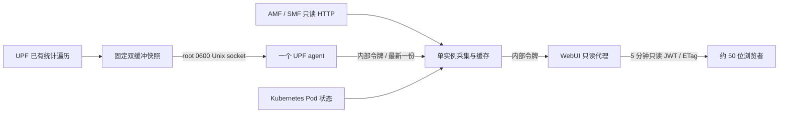

# WebUI 核心网监控

管理员的专载管理、会话释放与用户释放见 [WebUI 会话与用户控制](webui-core-control.md)。显式控制操作使用独立路由和有界审计，不改变监控轮询的数据路径。

NGAP ASN.1 / NAS 协议树、码流、容量限制和启用流程见 [WebUI 信令详情](webui-signaling.md)。Chart 默认开启监控及信令详情；从关闭状态启用时需在维护窗口操作。

监控采用单实例定时采集、独立进程内存缓存和 WebUI 只读接口。浏览器不会调用 `xcnctl`，也不会直接查询 AMF、SMF 或 UPF。事件按容量保留，无 30 分钟过期规则；速率曲线使用固定点数的环形缓存。

Chart 默认 `monitor.enabled: true`。2026-10-23 应用户明确要求，现场 `xcn` 已升级并启用监控演示，接入真实 OAI UE 并保持限速双向流量，见本文末尾记录。第一次启用会给 5gc Pod 增加 sidecar 和共享 socket 卷，触发 Pod 重建，需安排维护窗口；正式性能验收要求见下文。

## 数据路径



监控数据不写 MongoDB。MongoDB 仍用于原有订阅、模板、账户和登录；监控轮询路由在 session 中间件之前处理，不在每次轮询时访问会话数据库。登录后每 4 分钟更新一次监控令牌，原有管理 API 不能使用该令牌。

| 数据 | 周期 | 行为 |
| --- | --- | --- |
| AMF、SMF 事件 | 2 秒 | 每轮每网元最多 2 页，每页 1,000 条；按 boot_id / seq 去重和追踪缺口 |
| UPF 速率与规则 | 2 秒 | 一个 agent 读取，单批最多 4 MiB；不排队，不接受截断或超过 6 秒的快照 |
| UE、PDU 详情 | 10 秒 | 每页最多 100 条，完整批次最多 4,096 条、8 MiB；部分失败不覆盖上一份完整结果 |
| gNB | 15 秒 | 同一网元串行调度，避免多个任务同时查询 |
| 容器状态 | 30 秒 | 仅读取本 namespace Pod 的就绪状态与重启次数 |

周期可调慢，不能通过配置低于表中下限。失败采用退避，跳过错过的周期，不补发积压请求。浏览器约 2 秒刷新，有抖动、取消和 ETag；切到后台停止刷新。

页面包括概览、终端、基站、会话、事件和状态，支持浅色/深色主题、搜索、分页、详情和关联跳转。事件按协议筛选，默认 NGAP，可显示全部协议；事件与概览中的活动均为单行、毫秒时间。位置区分当前连接与最后已知位置，gNB 匹配包含完整 SCTP 对端、PLMN、ID 和位数，SEID 与累计计数以十进制字符串传递，避免 JavaScript 的 64 位精度丢失。

### 终端 SCTP 对端与同配置基站

终端列表在“接入基站”后显示“SCTP 对端”，详情同步展示原始地址，包括端口和 IPv6 方括号。只从最新完整 AMF 终端快照的 `gnb.peer` 读取：`cm_state=connected` 且 `gnb.status=associated` 时显示有效地址，否则显示“—”。不从 `location.gnb.peer` 补齐当前对端，不通过 gNB ID 或 NCI 反查地址；采样周期和现有数据源陈旧提示保持不变。

多台基站即使配置了相同 PLMN、gNB ID、位数和 NCI，仍按 SCTP 的 IP 与端口分别关联。当前关联终端使用 `UE.gnb`，观测小区使用 `UE.location.gnb`；两者都要求配置身份和有效对端完全匹配，缺失对端不作为通配。采样暂时不同步时允许没有匹配，不能猜测另一条连接。

`GET /api/monitor/ues` 和 `/api/monitor/gnbs` 新增可选 `sctp_peer` 精确筛选，内部接口同名参数。通过 URL 编码传递完整地址，例如 `sctp_peer=%5B10.2.0.119%5D%3A53783`；与已有 PLMN/ID/位数条件取交集。终端筛选只匹配当前连接，不包含空闲终端的最后位置。未指定该参数时保持原有筛选行为，响应字段不变。

终端与基站的跳转携带完整连接条件；缺失必要字段时禁用跳转。基站列表标识包含对端，详情独立查询监控缓存，保持所选连接，不依赖当前列表页的位置或排序。原连接消失或结果不唯一时提示关联信息不可用，不自动切换到同 ID 的另一台基站。

这些查询只读取现有缓存，不增加网元采样，不新增逐终端查询、历史存储或 MongoDB 访问。验证记录见[终端 SCTP 对端验证](ue-sctp-validation-20261030.md)。

当前界面不依赖 Metrics Server，不再查询 Metrics API 或轮询未展示的 AMF/SMF/UPF 原始指标。状态页保留实际采集器内存、水位保护状态、数据源更新时间，以及 Pod/容器就绪状态和重启次数；缓存容量、底层锁计时和绑核详情保留在内部诊断数据中。

## 内存与保留策略

**30 分钟是默认速率趋势窗口；原始采样保留最近 30 分钟，分钟汇总保留最近 24 小时，不是信令的有效期。** 页面时间范围为 5 / 15 / 30 分钟、12 / 24 小时，默认 30 分钟；本次不增加中英文切换。

| 对象 | 容量 |
| --- | --- |
| 事件 | 最多 20,000 条，且编码后的总长度最多 16 MiB；无时间淘汰 |
| 全部曲线 | 全局、用户、会话、承载、业务规则合计最多 1,024 条、128 MiB 预算；每条最多 900 个原始点、1,440 个已结束分钟桶和一个当前桶，分配前计入数组、索引和元数据的保守预算 |
| 承载曲线 | 最多 128 条、16 MiB，计入全部曲线预算 |
| 业务规则曲线 | 最多 256 条、32 MiB，计入全部曲线预算；内部辅助规则不记录历史 |
| Python 查询响应缓存 | 最多 128 项、8 MiB；大于 1 MiB 的响应不进入缓存 |
| WebUI 响应缓存 | 最多 64 项、16 MiB，1 秒有效期；相同在途请求合并 |
| WebUI 在途响应 | 最多 32 个不同请求；单响应最多 4 MiB，所有接收缓冲合计最多 16 MiB |
| 浏览器趋势缓存 | 最多 16 项、8 MiB 保守编码预算；最多同时执行两个历史请求，不缓存多选组合的完整副本 |
| UPF 快照 | 两份预分配数组，最多 4,096 会话 / 65,536 条规则，约 10 MiB；另有单份最多 4 MiB 的序列化响应 |

事件超限时按事件时间淘汰最旧记录；跨网元时间偏差可能影响此顺序。事件页和系统页显示实际起止时间及淘汰数量。低事件量时可以保留多天；缓存进程重启后，从网元仍存的环形缓冲重新读取，无法恢复已经被网元覆盖的事件。网元重启后保留已采集的旧 boot_id 事件，再从新序号起点增量读取。

编码字节数不等于 Python 进程内存。采集器还读取 cgroup v1/v2 实际内存用量、进程 RSS 和内存限制，采用实际限制与 `MONITOR_MEMORY_LIMIT_BYTES` 中较小值。Helm 通过 Downward API 注入容器 `limits.memory`。

- 保护水位为限额的 70%，恢复水位为 55%。默认 512 MiB 对应约 358.4 / 281.6 MiB。
- 读取 JSON 前检查原始大小，并保守预留最多该大小 32 倍的解析与派生开销；复制快照和生成查询结果前再次检查。
- 达到水位或预留空间不足时清空查询缓存，先回收业务规则、再回收承载历史；仍不足时减少事件到最多 1,000 条、丢弃用户和会话曲线，尽力归还分配器空闲页。保留全局曲线和最新完整快照。仍不足时拒绝新批次，暂停采集，详情查询返回 503；概览、健康与系统状态仍可查看。
- 降到恢复水位后自动允许采集。若最新状态本身已超出预算，需增加独立采集容器限额或降低详情规模；不能依赖历史淘汰解决无限规模的数据。

内存水位和预算为提前降载机制，不能把它解释为数学上保证永不 OOM。并发临时对象、运行库和分配器仍需余量；容器硬限额是最后一道边界。采集器独立于核心网进程，即使重启也不构成 UPF 转发的服务依赖。不要把采集器合并进 UPF 进程或 5gc 容器。

### 两级速率历史与查询

分钟汇总由 monitor 使用已经采集的速率生成，不额外查询网元。采用前值保持，按相邻有效采样的实际间隔加权；跨整分钟边界切分，超过三个采样周期的间隔或用户重新接入、UPF 重启等边界不外推。均值是**采样速率的时间加权均值**，不等于计费字节积分；峰值是已观测采样值的最大值，不代表瞬时峰值。有效覆盖不足 60 秒时保留部分覆盖信息，真实零流量和未采集数据分别处理。

30 分钟以内展示原始点，12 / 24 小时展示已结束的分钟桶。长期图表每分钟刷新，实时数值仍约两秒更新；“折线 / 曲线”只改变连线外观。提示框显示分钟均值、采样峰值和有效覆盖，横轴标明跨天日期。断档和部分覆盖桶之间不连接曲线；页面标示实际可用历史起止时间，不伪造尚未采集的历史。

曲线分配前检查条数和字节预算，按“全局/用户/会话、承载、业务规则”的优先级保留。同一层先淘汰最久未更新的不活跃曲线；只有活跃曲线时拒绝该层新增，避免每轮轮换已有历史。高优先级可回收低优先级历史。用户曲线按 SUPI 汇总多个会话，重新接入时断开连线；会话重新出现、身份变化、uptime 回退或 UPF 重启时创建新的曲线代次，避免 SEID 复用混入旧会话。快照按启动标识和单调时间拒绝重复、乱序；墙上时钟回退时重建历史代次。

`GET /api/monitor/trends`（内部对应 `/api/trends`）继续接受 `key` 与 `seconds`，后者限制在 60–86400 秒，默认 1800。`key` 支持 `global`、`user:<supi>`、`session:<seid>`、`bearer:<seid>:<qfi>`、`rule:<seid>:<pdr_id>`。可选、不透明的 `cursor` 用于增量；无游标返回完整窗口，游标代次不匹配或已越过保留窗口时返回 `reset: true`。

响应保留 `points: [[timestamp_seconds, ul_bps, dl_bps], ...]`，空值点表示断开；新增：

- `aggregation`：`raw` 或 `minute`；`resolution_seconds` 为名义采样间隔或 60。
- `buckets`：分钟元数据 `[timestamp_seconds, ul_peak_bps, dl_peak_bps, covered_seconds, sample_count]`，原始窗口为空。
- `available_from/to`：当前曲线实际已有历史范围；分钟范围按桶边界表示，桶内有效时长以 `covered_seconds` 为准。
- `window_start/end`：本次查询的时间边界；`epoch`、`cursor`、`reset`、`replace_from` 用于增量替换。

客户端保留 `replace_from` 之前且仍在有效范围内的旧点，再接入本次结果；不能对重叠桶求和。分钟响应重发末尾两个分钟范围，允许迟到的跨分钟有效采样修正边界桶。切换窗口、曲线或代次时重置。每条曲线单响应最多 3,000 行（包括断点），单图仍受固定点数限制；浏览器按对象缓存，最多 16 项、8 MiB，趋势 URL 不进入通用浏览器响应缓存。

历史响应使用独立曲线版本及时间边界生成共享缓存和 ETag，不因无关信令更新而失效。服务重启会清空全部历史，重新积累；退出用户的历史仍受 24 小时和总容量限制，内存压力可能提前淘汰。

## 承载级历史（2026-10-30）

会话页切换到“承载”后，可选择一条或多条 QoS 流查看上下行历史；会话详情的“QoS 流”行也提供“查看走势”，可在同一图表切换整个会话或指定 QFI。详情保持单选。默认使用曲线连线，仍支持折线。30 分钟内为原始采样，12 / 24 小时为分钟汇总；实时速率继续约两秒更新。

采集复用已有 UPF 快照，浏览者不会触发新的网元采集。不修改 UPF/VPP 转发路径、锁、CPU 配置，不增加容器或 Pod，也不写 MongoDB。

- 每条承载的上下行合并存入一份固定容量曲线，约 112 KiB；6 条约 0.65 MiB，128 条约 13.7 MiB（含保守元数据预算）。
- 承载子预算最多 128 条、16 MiB，**包含在**全部历史 1,024 条、128 MiB 的总预算内。分配前同时检查条数、数组与字典占用预算，以及容器实际内存水位。
- 自动记录容量内全部承载。优先淘汰最旧的不活跃承载；只有活跃承载时拒绝新增，避免轮流挤掉现有历史。全局、用户、会话历史优先，需要空间时可回收承载历史。
- 原始环形缓存为 900 点，分钟环形缓存为 1,440 桶。不活跃历史最多保留 24 小时，容量或内存压力可提前淘汰。监控重启后历史重新积累。
- monitor 容器仍为 512 MiB 限制；70% 水位触发保护、55% 以下恢复。高水位先清响应缓存、回收业务规则和承载历史；仍处于高水位时沿用更广泛历史回收，保留最新状态。曲线预算不等于进程总内存，响应序列化、快照解析等仍受现有预留及请求限额保护。

承载实例由会话身份、UPF 启动标识、QFI、PDR/QER/规则 generation 的固定长度摘要及 uptime 回退检测区分。普通 QoS 参数变化而统计规则实例不变时连续；规则实例改变、消失后重新出现、会话复用或 UPF 重启时重建 epoch，避免串接旧数据。缺少规则代次等可靠标识时只显示实时速率，历史明确标为不可用。不会按 QFI 数值猜测默认流/专载类别。

`rates?level=bearer` 的行及 `sessions` 的 `bearers` 附带 `trend_key`、`trend_epoch`、`history_state`、`history_reason`。承载趋势响应也包含状态：

| history_state | history_reason | 含义 |
| --- | --- | --- |
| recording | null | 正在记录当前实例 |
| released | null | 承载已不在当前快照中，保留的旧历史可继续查看 |
| unavailable | capacity | 历史容量不足，实时速率仍可查看 |
| unavailable | memory | 内存保护暂停历史 |
| unavailable | identity | 缺少可靠实例标识 |
| unavailable | absent | 承载不存在或历史已淘汰 |

分钟缓存也会检查实例 epoch 和记录状态；释放后不自动切换到另一条承载，重用同 QFI 时立即请求新实例。缓存代理短暂返回旧 epoch 时快速重取，不能把旧实例继续缓存一分钟。采样失败和时间断档不补零，不跨断档平滑连线。

验证记录见 [承载历史验证](bearer-history-validation-20261030.md)。

## 业务规则历史与多选对比（2026-10-30）

会话页的用户、会话、承载、业务规则四个层级各自保留选择，支持行复选框和“选择对象”弹窗。弹窗支持搜索、分页、跨页选择及应用/取消；同一层最多 8 个对象。首次进入选择首个可用对象，手工清空后保持空选；搜索或翻页不替换已选对象。点击 SUPI 仍打开原详情，详情内保持单对象走势，打开详情时暂停背景对比的历史请求。

单选时上行蓝色、下行绿色，两条均为实线，概览和详情的单对象图沿用此规则。多选时同一对象使用固定颜色，**下行实线、上行点线**，双向对象最多 16 条线；业务 PDR 只画该规则实际方向。按勾选对象数切换样式，筛选方向或隐藏图例不改变模式。可筛选上下行、滚动图例及隐藏指定线条。折线/曲线默认曲线，仅改变连线外观，采样值不变。

只有核心网上报 `rule_kind=business` 的规则记录历史，标识为 `rule:<seid>:<pdr_id>`。内部辅助规则和用途未确认规则没有走势图，不按 QFI、QER 或零速率推测类别。可靠实例指纹包括 UPF boot、会话身份、PDR、QER、QFI、方向及 generation；普通 QoS 更新连续，规则代次变化、会话复用、uptime 回退等会重建 epoch。零业务速率仍记录，未采集数据保留断点。历史不足容量、内存保护、标识缺失及已释放等状态逐对象说明。

全部历史共享 1,024 条、128 MiB；用户和会话没有独立预留条数，承载 128 条/16 MiB、业务规则 256 条/32 MiB 都计入总额。内部诊断的 `health` 返回 `curves`、`trend_bytes`、`trend_byte_limit` 以及承载/规则各自条数、字节、限额和拒绝计数。条数和字节任一达到上限就执行容量策略，实际内存水位还可能提前回收。

新增只读 `GET /api/monitor/trends-batch`，内部为 `/api/trends-batch`：

- `seconds` 与单对象接口相同；`curves` 为 JSON 数组，包含 1–8 个不重复、同层级对象。例如 `[{"key":"rule:1086:1","supi":"imsi-460110000000100"}]`，通过 URL 编码传递。
- 每项可带独立 `cursor`；`status_only:true` 仅返回当前摘要和历史状态。`supi` 作为原归属前置条件，标识被其他用户复用时返回 `history_reason:instance`，不拼接新用户数据。
- 响应 `items` 各含 `key`、`object`、`trend_key`、`trend_epoch`、`history_state`、`history_reason`。完整查询另含与单对象接口一致的点、桶、窗口、epoch、cursor 等字段；状态查询不携带历史点。
- URL 最长 4 KiB、完整响应最多 4 MiB；复用单曲线响应缓存，不在采集器长期缓存组合。WebUI 继续使用现有只读 JWT、合并、超时和总缓冲限制。
- 浏览器分钟视图每约两秒检查状态，每分钟获取增量历史；实例或记录状态变化时立即刷新历史。`rates?purpose=selection` 提供分页后的精简对象字段，避免选择弹窗携带全部嵌套规则。

实现只读取现有快照与内存缓存，未增加网元采样、UPF/VPP 处理、Pod、容器或资源限额。容量、真实协议回放、页面及上线验证见[业务规则历史与多选验证记录](comparison-history-validation-20261030.md)。

## UPF 与 CPU 隔离

UPF 进程仅在设置 `XCN_UPF_MONITOR_SNAPSHOT=1` 时分配快照和创建查询线程；Chart 在监控开启时注入该变量。不开启时沿用原统计及 CLI 单线程路径。可选快照分配或查询线程创建失败会回退到旧路径。

新快照借用已有统计线程及其已有的规则读锁遍历，复制有界标量，不保留 session 指针；不增加包处理路径的锁、分配或序列化。固定双缓冲使用原子所有权，缓冲被占用就跳过。JSON、地址格式化和 socket I/O 都在规则锁外进行。旧 CLI 与统计线程共享的速率字段由专用 mutex 保护，采样端只 trylock，不等待；转发线程不使用此 mutex。统计和 socket 线程沿用现有控制线程绑核规则。

这会略微延长原有统计读锁持有时间，仍需测量控制面写入与高负载转发的影响，不能据此宣称“零性能影响”。socket 客户端读写有超时，关闭客户端不会因 SIGPIPE 结束 UPF。停止 agent 后订阅 6 秒到期，停止快照复制。

`monitor.cpuSet` 默认留空。各容器只需配置各自的 `resources.requests.cpu` 和 `resources.limits.cpu`，支持 `200m`、`900m`、`1`、`2` 等数量，由现有 CPU Manager 选择核号。采集器使用 `monitor.resources`，UPF agent 使用 `monitor.agentResources`，信令 agent / decoder 使用 `monitor.trace.agentResources` / `decoderResources`，WebUI 使用 `monitor.webuiResources`，各自独立限制。

监控和 WebUI 默认 CPU 上限为 `900m`，decoder 为 `500m`，两个 agent 各为 `250m`；五个角色合计申请 `650m`，保留原有的小额预算，不默认预留五个整核。监控和 WebUI 的内存上限仍为 `512Mi`。

启动入口通过 Downward API 获取本容器的 CPU 上限，并只读检查 cgroup v1/v2 的实际 cpuset。整数核上限等待相应数量的逻辑 CPU；有 `ISOCPU` 时还验证两者一致，偶数分配在同一物理核的两个 SMT 线程上同样有效，不改变 CPU Manager 的选择。分数核使用 CPU Manager 的共享集合；若容器仍暴露节点全部在线 CPU，则等待分配完成。默认最多等待 `monitor.cpuSetWaitSeconds: 120` 秒，启动探针留出对应时间，超时不在全部 CPU 上继续运行。自动模式不写 cgroup、配额或线程 affinity，后续共享集合调整仍由 CPU Manager 接管。

采集器继续读取实际 `xnet.com/used-core` 注解，校验与 UPF/VPP 及其 SMT 兄弟无重叠；无法验证时停止 NF 采集，后续 Pod 分配变化也会重新验证。两个 agent 和 decoder 使用各自实际集合校验，不借用另一个容器的核号。`monitor.cpuSet` 仍可作为兼容手动覆盖，但必须自行确认空闲核及容器允许范围。该自动模式依赖 CPU Manager 正确隔离共享集合；不会在未配置隔离的节点上自行挑核或伪装就绪。

切换该启动方式需要配套构建新版 monitor 与 WebUI 镜像；仅修改 Chart、继续使用缺少新启动入口的旧镜像不能启用自动模式。

2026-10-28 在独立 Docker 测试容器验证：整数 CPU 分配未收敛时不启动子进程，实际 cpuset 收敛后正常启动；同一物理核的两个 SMT 线程被正确识别为两个逻辑 CPU；共享集合扩大后主进程能继续使用新增 CPU；整数与共享模式等待超时均拒绝启动。新版 WebUI 的 Python 入口能成功 exec Node，四个监控角色能在自动模式运行并通过健康检查。监控回归 74 项中 73 项通过（含 18 项 CPU 分配测试及真实协议解码），仅 xcnctl 对照测试因未配置该程序跳过；Helm 回归 38 项及 lint 通过。本轮未修改 CPU Manager、未部署到现场，因此这些结果不代表现场吞吐和时延验收。

同日随后按用户授权完成默认配置现场重部署，补齐 xcnctl 对照后监控 74 项全部通过，并执行六 UE 双向流量、50 阅读者、监控中断和控制操作实测。结果及现场 NAS 完成回复缺失的边界见[默认配置现场验收记录](default-config-live-validation-20261028.md)。

```bash
lscpu -e=CPU,CORE,SOCKET,ONLINE
kubectl -n xcn get pods -o wide
kubectl -n xcn get pods -o json | python3 -c '
import json,sys
for p in json.load(sys.stdin)["items"]:
    print(p["metadata"]["name"], p["metadata"].get("annotations",{}).get("xnet.com/used-core", "无分配注解"))'
```

本地实验专用 `MONITOR_REQUIRE_AFFINITY=0` 不出现在 Helm 清单中，不可用于生产绕过核验。CPU 注解、Metrics API 或容器状态缺失都不应伪造为正常值。

## 构建、启用和停止

“核心网控制台”标题下方以一行小号文字显示部署版本：`Chart` 对应 `Chart.yaml` 的 `version`，
`App` 对应 `appVersion`。Helm 自动通过 `XCN_CHART_VERSION`、`XCN_APP_VERSION`
传入 WebUI；修改 Chart 元数据并升级后，刷新页面即可看到新值，无需重新构建
前端来更新版本号。`GET /api/version` 只返回这两个固定字段，不经过登录会话、
MongoDB 或核心网采集；页面加载时请求一次。独立 Docker 部署可传入相同环境变量，
未配置时不显示版本信息，不使用源码中的默认版本冒充现场版本。

2026-10-27 验证：35 项 Helm 检查、现有控制权限及监控接口回归通过；
Playwright 21 项检查覆盖 11px 字体、深浅主题、320/390px 窄屏和切换页面
不重复请求。已部署为 revision 206，现场返回 Chart `0.1.0`、App `2.7.7`。
只重建 WebUI，其他四个 Pod 的 UID、重启数及密钥保持不变，六个会话和
十二路实际速率核验正常。

后续布局调整将两个版本号移到“核心网控制台”下方，以一行 11px 灰字显示。
18 项浏览器检查覆盖标题对齐、单行排版、深浅主题及 320/390/1440px 布局，
通过后仅更新 WebUI 到 revision 207，其余 Pod、会话及灌包保持正常。

镜像构建在开发/构建主机执行；不要在正在承载业务的转发 CPU 上构建。UPF 运行镜像构建流程沿用项目现有 `docker/runtime/Dockerfile`，需要包含本次 `rate-snapshot` 改动。WebUI 和采集镜像如下，标签使用实际提交版本：

```bash
docker build --network host -f monitor/Dockerfile -t localhost:5000/xcn-monitor:YOUR_TAG .
docker build --network host -f docker/webui/Dockerfile -t localhost:5000/xcn-webui:YOUR_TAG .
```

`xcn-monitor` 已同时包含信令 decoder，四个监控角色使用同一镜像、不同容器启动命令；无需另建解码镜像。空的 `collectorImage`、`trace.agentImage`、`trace.decoderImage` 字段继承 `monitor.image`。原 values 中的显式旧镜像仍有优先级，迁移时需清空或同步更新，详见[信令构建说明](webui-signaling.md#构建与启用)。

有 Clash/代理时先验证构建网络。主机回环代理用于 `--network host` 构建的 RUN 阶段时，可显式传入 `--build-arg HTTP_PROXY=http://127.0.0.1:7890 --build-arg HTTPS_PROXY=http://127.0.0.1:7890`；镜像不持久化这些构建参数。Docker 守护进程拉取基础镜像使用独立网络设置，`--network host` 不会修复该阶段。不要为此重启生产 Docker 或全局更改代理。

启用前保存实际 release 值和回滚 revision，检查镜像可拉取及 CPU Manager 的分配状态。默认按资源数量配置，不填写机器专属核号。生成覆盖文件后先 `helm diff`（若已安装）或 `helm template` 检查差异，重点查看 5gc Pod、原 UPF/VPP 配置和现有资源限额。

```bash
helm get values xcn -n xcn -o yaml > /tmp/xcn-before-monitor-values.yaml
helm history xcn -n xcn
cat > /tmp/xcn-monitor-values.yaml <<'YAML'
monitor:
  enabled: true
  cpuSet: "" # 使用各容器的资源数量和 CPU Manager 实际分配
  cpuSetWaitSeconds: 120
  image:
    repository: localhost:5000/xcn-monitor
    tag: YOUR_TAG
images:
  runtime:
    repository: localhost:5000/xcn-runtime
    tag: YOUR_RUNTIME_TAG
  webui:
    repository: localhost:5000/xcn-webui
    tag: YOUR_TAG
YAML
helm template xcn ./helm/xcn -n xcn \
  -f /tmp/xcn-before-monitor-values.yaml -f /tmp/xcn-monitor-values.yaml > /tmp/xcn-monitor-review.yaml
```

性能验收通过后，在维护窗口执行同样参数的 `helm upgrade xcn ./helm/xcn -n xcn -f ...`。UPF 统计必须已开启，采样周期不大于 2,000 ms，socket 必须在独立目录（如 `/run/xcn/upf-stats.sock`）中；Helm 会拒绝不安全的挂载目录。内部共享令牌自动生成并在升级时复用，也可通过 `monitor.existingSecret` 提供有 `token` 键的 Secret。UPF UDS 保持 root 0600，agent 使用 root UID、无 capabilities、只读根目录和只读 socket 卷。

仅修复采集器时，可用 `monitor.collectorImage.repository/tag/pullPolicy` 覆盖其镜像；未填写的字段沿用 `monitor.image`。保留 agent 的 `monitor.image` 后，这类更新只重建独立采集器，不改变 5gc、core 或 WebUI 的 Pod 模板。变更前仍应比较实际渲染结果。

紧急停止采集时，修改 `monitor.config.enabled=false`，不要先把 `monitor.enabled` 改成 false。前者仅修改挂载的 ConfigMap，不改变 Pod 模板，不重启核心网；等待 Kubernetes 投射更新后，采集器和 agent 停止，UPF 订阅随后到期。可调整配置周期同理。若只需立即关闭，可直接编辑监控 ConfigMap 的 `config.json`；后续 Helm 升级需同步保存该值。

彻底卸载监控、回退 UPF 镜像或更改 `monitor.enabled` 会再次改变 5gc Pod，需维护窗口。使用保存的 revision 执行 `helm rollback xcn REVISION -n xcn --wait`，并核对实际 AMF/SMF/UPF/VPP 镜像、Pod 就绪、注册和数据转发恢复。不要只回退前端而遗留未知版本的用户面改动。

## 验证与上线门槛

开发阶段在隔离容器和本机测试端口完成以下验证；这部分测试不占用现场 9999，也不修改线上 release：

- UPF 真实 Meson/Ninja 严格编译；快照所有权并发、忙时跳过、租约过期、转义及 uint64 边界测试，通过 ASan/UBSan 和泄漏检查。
- 既有 32 项 `xcnctl` 单元测试通过。监控 16 项测试通过，含真实 CLI UE/gNB 字段比较、关联歧义、旧数据保留、事件启动/重启游标、无时间淘汰、容量上限、内存保护和 100 读者不增加 NF 请求。
- 实际 Python 3.12 镜像在 128 MiB、禁 swap 的独立容器中触发保护后恢复，cgroup `oom_kill=0`、`memory.failcnt=0`。
- 最终 UPF 开启监控时完成 1,500 次 UE 生命周期；关闭监控完成 500 次。最终协议探测读取 62 份快照及 63 次旧 CLI，最多 100 会话/400 规则，观测到最大读锁等待 10 μs、持有 134 μs。该数据来自隔离 UDP/TUN 功能测试，不能外推到 VPP 线速负载。
- Next 生产构建、只读 JWT 权限、50 读者请求合并、ETag、绕过 session/MongoDB、隔离库的订阅/模板/账户 CRUD 已验证。浏览器检查覆盖搜索/分页/连接状态筛选、gNB→UE→PDU、四级速率、事件与内存状态，以及浅色/深色、刷新保留主题和 390 px 移动端无整页横向溢出。

并发实验分两轮，避免把过程中新增的内存保护误写成已经过 30 分钟长测：

| 实验 | 监控请求 | 失败 | P95 | P99 |
| --- | --- | --- | --- | --- |
| 50 VU / 30 分钟，补充实际内存水位前的版本 | 56,520 | 0 | 11.96 ms | 40.67 ms |
| 50 VU / 5 分钟，增加内存水位与事件容量策略，Python 3.12 / Node 19，512 / 128 / 512 MiB 独立容器 | 9,332 | 0 | 40.14 ms | 113.55 ms |

两轮均使用真实登录、短期 JWT 续签及实际采集服务，全部检查通过。30 分钟期间采集器 RSS 从 79.82 MiB 到 80.16 MiB，观测峰值 80.76 MiB；agent 峰值 34.79 MiB，WebUI 峰值 133.20 MiB。无浏览者与 50 浏览者时 AMF/SMF 事件源请求分别约 0.48 / 0.49 次每秒，详情约 0.10 次每秒，指标与 gNB 约 0.067 次每秒，均未按人数放大。

限额容器复核的后 180 秒观测到采集器 / agent / WebUI RSS 峰值约 84.46 / 37.62 / 102.19 MiB；三个容器 cgroup 的 `memory.failcnt` 和 `oom_kill` 均为 0。其事件源约 0.47 次每秒、详情约 0.094 次每秒，配额下会跳过错过的周期。最后补充的全局曲线不被个体曲线挤出的边界另由容量单测覆盖。上述延迟是监控 HTTP 接口延迟，不是用户面报文时延。

可重复的基本检查：

```bash
python3 -m pip install -r monitor/requirements.txt
python3 -m unittest discover -s monitor/tests -p 'test_*.py'
node webui/server/tests/monitor-test.js
npm --prefix webui run build
helm lint helm/xcn
```

`monitor/tests/lab.py` 仅提供测试来源，包含 100 UE、200 会话、800 QFI、1,600 条双向规则。压测应连接真实采集器、agent、WebUI 和隔离 MongoDB；禁止将实验 fixture 接入生产。`browsers.k6.js` 使用真实登录、每 4 分钟续令牌、50 VU 与 2 秒混合页面轮询，默认持续 30 分钟；`observe.py` 记录 NF 请求速率、RSS、FD、线程和 CPU。可用 `DURATION` / `VUS` 调整。凭据只供专用测试账户使用，勿提交到仓库。

**正式用户面性能验收仍须完成**：原版本、修改后关闭、新版开启无浏览器、新版开启 50 浏览器四组，同样的 CPU/NIC/VPP 配置与 UE/会话规模，小包/大包、双向流量及会话增删，各至少 3 次。比较吞吐、丢包、P50/P95/P99 时延、UPF/VPP CPU、原读锁等待和持有时间。不得有超出噪声的可重复退化；吞吐下降超过 1% 或 P99 增加超过 5% 直接拒绝上线。当前没有完成该 VPP/物理链路性能验收；Chart 继续默认关闭，下面的现场演示仅验证真实接入、限速流量和网页功能。

## 2026-10-23 现场演示

用户要求升级当前核心网、接入用户并保持灌包。现场 Helm release 为 `xcn` / namespace `xcn`，初次启用演示的最终 revision 为 `181`，网页入口为 `http://10.2.0.119:9999/`。保留原 VPP/memif、N3/N6 地址、路由、用户地址池及核心网资源配置；升级前的 revision 为 `178`，备份保存在本机 `/tmp/xcn-live-upgrade-eac6bb782/`，目录仅所有者可访问。

| 组件 | 实际镜像 |
| --- | --- |
| 核心网 | `localhost:5000/xcn-runtime:monitor-eac6bb782-1023` |
| WebUI | `localhost:5000/xcn-webui:monitor-eac6bb782-1023` |
| UPF agent | `localhost:5000/xcn-monitor:monitor-eac6bb782-1023` |
| 独立采集器 | `localhost:5000/xcn-monitor:monitor-event-ts-1023` |

核心网由 `eac6bb782` 全量 Meson/Ninja 编译并安装，`upf_memif=true`，运行镜像启动及动态库检查通过。现场发现 cJSON 会把部分整数微秒时间戳输出成科学计数法，现已允许安全整数范围内的有限、无小数浮点时间戳，并归一化为十进制字符串；序号仍严格保留 uint64 字符串。回归测试覆盖真实线格式、非法浮点数、越界和失败时保留游标，全部 17 项测试含 CLI 等价检查通过；实际 Python 3.12 镜像通过 16 项、跳过依赖完整核心网动态库的 CLI 等价检查。

重新接入 1 个 OAI gNB 和真实 UE `imsi-460110000000100`，UE IPv4 为 `10.45.0.3`、DNN 为 `cmnet`、PSI 为 `2`。验证时核心网 10/10 就绪，NRF/SCP 2/2 就绪，无新增容器重启；网页显示 1 个 connected UE、1 个 gNB、1 个 PDU 会话和 55 条真实控制面事件。浏览器检查覆盖概览、事件、详情与主题，速率与 `xcnctl show rate` 对照一致。

演示使用 UE 到本机 `10.2.0.119:15201/15202` 的 UDP 流量，上下行各 `2 Mbps`、应用报文 `1200` 字节。灌包进程分别绑定 CPU `38/39`，接收服务绑定 CPU `40`；监控、agent 和 WebUI 使用 CPU `36-37`，采集器已通过现场 UPF/VPP 及 SMT 兄弟核校验。UPF 统计约为上下行各 `2.05 Mbps`，包含用户 IP/UDP 开销；已完成的分钟接收统计为零丢包。最终灌包改为每小时一轮并自动重连，日志按轮覆盖；保留运行供用户查看。

| 现场短测 | 监控请求 | 失败 | P95 | P99 |
| --- | --- | --- | --- | --- |
| 50 浏览者 / 2 分钟，事件解析修复前 | 3,664 | 0 | 4.32 ms | 60.89 ms |
| 50 浏览者 / 1 分钟，最终采集器 | 1,787 | 0 | 5.59 ms | 79.21 ms |

最终短测包含真实登录、事件和速率页，监控请求全部成功。AMF/SMF 事件和 UPF 快照各约 `0.492` 次/秒，UE/PDU 详情各约 `0.095` 次/秒，没有随 50 个浏览者增加到逐浏览器查询；结束时采集器实际内存约 `42.94 MiB / 512 MiB`，事件源无错误。表中的延迟只指监控接口；集中登录另有秒级耗时，不能作为用户面时延数据。

集群未提供 Metrics API，页面明确提示容器实时 CPU/内存用量不可用；采集器自身实际内存保护、网元指标、Pod 就绪状态、注册/会话、速率和事件可正常查看。现场 gNB 的广播 NCI 与 gNB ID 存在原有不一致，页面沿用网元报告，不隐藏此状态。

演示流量的临时停止脚本只停止本次两个客户端和接收服务，不卸载 UE 或核心网：

```bash
bash /tmp/xcn-live-upgrade-eac6bb782/stop-traffic.sh
```

该脚本和验证日志位于当前主机的临时目录；需要长期保留时应另行归档。停止采集仍使用前述 ConfigMap 开关，避免为了关闭网页采集而重建 5gc Pod。

## 2026-10-23 网页优化

按用户要求统一“概览、终端、基站、会话、事件、状态”的页面与导航名称。概览移除 AMF/SMF/UPF 示意图与重复说明，集中显示终端、基站、会话数量、双向流量和近期事件；状态页移除 Metrics API、原始网元指标、缓存保留策略和绑核调试信息，保留采集器实际内存、数据源及容器健康状态。

用户速率汇总补充去重、排序后的 DNN 列表和会话数。用户抽屉按实际会话分别展示承载与规则，完整字段包含各会话的原始结构，展开时才生成 JSON；跨页打开终端时从缓存补齐终端详情。事件按协议筛选，默认 NGAP，支持所有已采集协议及“全部协议”；时间精确到毫秒，单行显示，长字段可在详情中查看。事件详情始终保持所选 event_id，避免轮询时按同一 SUPI 错配到另一条记录。

发布为 Helm revision `182`，仅更新 `localhost:5000/xcn-webui:ui-refine-1023` 和独立采集器 `localhost:5000/xcn-monitor:ui-refine-1023`。UPF agent、核心网、数据库配置与 Pod UID 均保持不变，真实 UE 与上下行各 2 Mbps 灌包持续运行。升级前 Helm 值、清单、Pod 状态、测试及浏览器记录保存在本机 `/tmp/xcn-ui-refine-1023/`。

- 20 项回归测试及 Next 生产构建通过，覆盖多 DNN、精确累计计数、协议过滤和不依赖 Metrics API 的 Pod 采集。
- 独立预览验证 100 终端、200 会话、600 事件；同一用户的两个 DNN、两份会话各 4 个承载和 8 条规则均可查看，SEID `9007199254740993` 保持准确。覆盖搜索、协议切换、分页、完整字段展开/收起及事件身份稳定。
- 现场 Chromium 检查真实 `cmnet` 用户、1 个承载、4 条规则、基站关联、NGAP/SBI/全部协议、毫秒事件、状态页及浅色/深色主题。390 px 下整页及主内容区均无横向溢出，长表格保留区域内滚动。
- 最终 50 VU / 1 分钟短测完成 1,776 次监控请求，失败 0，P95 9.60 ms，P99 137.79 ms。AMF/SMF 事件及 UPF 快照各约 0.492 次/秒，UE/PDU 详情各约 0.095 次/秒；Metrics API 与原始网元指标轮询均为 0。结束时采集器实际内存约 42.99 MiB / 512 MiB。该短测不替代前述正式用户面性能验收。


## 2026-10-26 两级速率历史

本次保持中文界面，时间范围为 5 / 15 / 30 分钟、12 / 24 小时，默认 30 分钟；未增加 1 / 6 小时。折线/曲线仍只影响连线，默认曲线。会话管理文案统一为“新建专载、修改专载、删除专载、修改默认承载”，删除确认按钮明确为“确认删除专载”；控制参数及接口不变。

验证记录：

- Python 最终测试集 56 项，53 项通过、3 项因外部依赖跳过；其中 CLI 一致性另外使用实际 `xcnctl` 及动态库通过，真实 NGAP/NAS 解码测试在解码器镜像中补测 18 项全部通过。包含独立逐秒参考计算、跨分钟、间断、48 小时时钟推进与环形覆盖、重连/实例复用、游标重叠替换、容量/内存边界和分钟 ETag 稳定性。
- 前端增量合并测试、监控代理权限/合并/ETag 测试、控制接口既有回归及最终 Next 生产构建通过。Playwright 检查五种范围、默认模式、图表与 API 逐点一致、用户/会话详情、分钟均值/采样峰值/覆盖提示、主题、390 px 窄屏及控制文案。隔离页面模拟历史接口 503，已有曲线保留并在恢复后继续更新；24 小时视图观测约 60–62 秒一次增量请求。
- 512 条曲线预填充合成 48 小时历史，再在真实墙钟时间连续运行 7,201.94 秒；50 并发读取者每 2 秒访问，另有约 2 秒快照上传。完成 179,850 次查询、3,544 次上传，错误 0；512 MiB 禁 swap 容器内存峰值 122,720,256 字节（117.04 MiB），曲线预算 57,189,057 字节（54.54 MiB），OOM 0，无内存回收/暂停。查询 P95 10.88 ms、P99 32.59 ms。合成历史只用于隔离验证，不进入现场。
- 隔离环境真实登录 → WebUI 代理 → 采集缓存的 50 VU / 30 分钟测试完成 71,845 次 HTTP 请求、157,367 项检查，失败 0；历史查询 P95 6.12 ms、最大 171.81 ms。160 MiB 独立容器另验证高水位回收、低水位恢复，OOM 0。这些是监控服务测量，不是用户面时延。

部署为 Helm revision `199`，仅将 collector 镜像和 WebUI 镜像更新为 `localhost:5000/xcn-monitor:history-1026-r3`、`localhost:5000/xcn-webui:history-1026-r3`。升级前服务端 dry-run 与旧清单比较，仅上述两个 Deployment 的容器镜像变化；部署后核心网及数据库 Pod UID 不变、无新增重启，核心网、agent、decoder 镜像、采样周期、CPU/CFS 配置均未改变。decoder 随监控 Pod 一起重建。曲线仍仅存在于内存，监控重启后从新采样开始积累，页面显示实际已有历史。

备份、压力测试、页面检查及现场原始结果在本机私有目录 `/tmp/xcn-history-1026/`，截图在 `output/playwright/history-*.png`。本次没有修改 UPF/VPP 或原生控制面代码，不替代前述完整线速和物理链路性能验收。


现场同流量短测：升级前后各对 6 个终端发送 1,000 个 ICMP 探测包（间隔 200 ms），两组均为 6,000/6,000 收到、零丢包。各终端 P99 从升级前 29.2–30.2 ms 到升级后 29.1–30.3 ms，未观察到明显退化。既有上行 0.5/1/1.5/2/2.5/3 Mbps 和下行 1/2/3/4/5/6 Mbps 灌包持续运行；升级后检查的六份下行接收日志合计 525,000 个包，丢包 0。采集器与 WebUI 实际内存分别约 30.83 / 75.84 MiB（各限额 512 MiB），内存分配失败计数 0，采集器 OOM 0。这是当前限速演示流量的短测，不能外推为线速或所有负载下无影响。

经用户明确授权，完成现场 **50 并发读者**补测：在 WebUI 容器内签发有效期 5 分钟、仅含 `monitor:read` 权限的测试令牌，密钥未离开容器、未输出或落盘。客户端仅 GET 监控接口，没有访问控制写接口；该测试模拟已登录浏览者的读取节奏，实际登录链路的压力由前述隔离长测覆盖。

先进行 60.39 秒未新增测试读者的基线，再进行 120.66 秒的 50 读者负载：实时速率每 2 秒查询，全局及用户/会话的 24 小时历史每 60 秒增量查询。完成 3,200 次负载查询，错误 0，监控 HTTP P95 37.52 ms、P99 190.08 ms。现场保持 6 个终端、6 个会话，共 13 条曲线，曲线预算占用 1,460,290 字节；测试期间及结束时观测到的采集器内存最高约 45.39 MiB / 512 MiB，未触发暂停或回收，结束后 cgroup 分配失败计数及 OOM 均为 0。

| 指标 | 未新增测试读者 | 50 并发读者 |
| --- | --- | --- |
| UPF 快照、AMF/SMF 信令采样（次/秒） | 0.4968 | 0.4972 |
| AMF 终端、SMF 会话采样（次/秒） | 0.0994 | 0.0994 |
| gNB 采样（次/秒） | 0.0662 | 0.0663 |
| 6 终端 ICMP 收到/发送 | 1,800 / 1,800 | 3,600 / 3,600 |
| 各终端 ICMP P99 范围 | 29.8–31.7 ms | 28.5–30.0 ms |

采样频率未随浏览者人数增长，探测均零丢包，未观察到尾延迟升高。原灌包持续运行；负载阶段结束时读取各终端下行日志末尾 14 个统计区间，合计 306,250 包、丢包 0，下行分别保持 1/2/3/4/5/6 Mbps。上述日志窗口可能包含负载阶段开始前的少量时间，不作为精确对齐的全程吞吐测量。所有 xcn Pod 就绪，测试前后 UID 及重启计数不变。原始结果见 `/tmp/xcn-history-1026/live-readers.json`、`concurrent-{baseline,loaded}-ue-*.log` 及 `pods.concurrent-*.json`。此现场短测没有覆盖完整线速、所有报文大小及高频会话生命周期负载。
