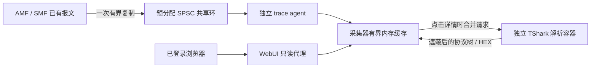

# WebUI 信令详情

事件详情支持 NGAP ASN.1 协议树、5GMM / 5GSM 明文、NGAP 内嵌 Transfer、字段搜索、字段对应字节以及复制。默认隐藏 PER 编码辅助字段，可手动展开。协议树与码流使用同一条事件的 `NF / boot_id / seq` 关联，不根据 IMSI 或相邻时间猜测配对。原有事件摘要和采样路径继续工作。

## 数据路径与性能边界



AMF / SMF 不生成 JSON、运行 TShark、访问数据库或等待网页请求。生产者使用 C11 原子操作、单生产者单消费者共享内存，先验证边界、容量和速率，再复制。发送 NGAP 在现有 SCTP 发送消耗缓冲前复制，发送结果生成后发布原有事件序号；不保留报文指针。NAS 使用核心网本来就编码或解密后的缓冲，不额外编解码，也不导出核心网安全上下文。完整性校验状态按本条消息记录；失败不会被误标为校验通过。下行 NAS 标记为“发送前明文”，不代表 UE 已收到。

没有修改 UPF / VPP 转发代码，也没有新增用户面锁。采集、上传和解析仍会使用有限 CPU、内存及共享宿主机资源，**不能仅凭架构宣称吞吐和时延完全不受影响**。监控进程绑定空闲 CPU；采集器验证 UPF / VPP 的实际分配，并排除已在运行注解中声明的 AMF / SMF CPU 及其 SMT 同胞。UPF / VPP 分配不可确认或发生重叠时暂停采集和解析。若 AMF 使用共享 CPU 且没有独占分配注解，还需在上线性能验收时核对其实际调度竞争。

| 环节 | 硬限制与超限行为 |
| --- | --- |
| 共享环 | AMF 256 槽、SMF 128 槽，每槽最多 32 KiB；共享 tmpfs 卷上限 32 MiB，启动预分配，失败只停用详情 |
| 核心网复制 | 每 NF 1,000 条/秒且 1 MiB/秒，允许一秒突发；环满、超长或限速时丢弃详情，不等待业务线程 |
| 采集租约 | agent 每约 2 秒续租，最长 6 秒失效；租约失效后跳过复制 |
| agent | 250m CPU / 128 MiB；单批最多 1 MiB / 256 条，上传超时 1 秒，无重试积压队列 |
| 原始 PDU 缓存 | 最多 20,000 条且 64 MiB，按容量淘汰，无时间 TTL |
| 已解析缓存 | 最多 256 条且 32 MiB 编码 JSON；同一事件合并在途任务，解析器版本改变时清空 |
| 采集器总内存 | 容器仍为 512 MiB；实际 cgroup / RSS 达 70% 水位停止接收并回收，降到 55% 后恢复；码流和解析缓存优先回收 |
| 解析器 | 独立容器 500m CPU / 512 MiB；一次一个 PDU，最多排队 64 个事件 ID；子进程 2 秒超时后终止并回收 |
| 解析输出 | PDML 最多 4 MiB、10,000 个节点、深度 64；单条 JSON 最多 1 MiB；HEX 每页 512 字节 |
| WebUI | 登录后的只读令牌，详情不进入浏览器或代理的常规响应缓存，返回 `Cache-Control: no-store` |

编码字节上限不是 Python 实际内存上限，另有对象开销、查询响应和解码临时数据，因此还保留实际内存水位保护。详情不写 MongoDB，重启后不恢复历史码流。摘要与码流独立保留，摘要存在时码流也可能已淘汰。状态接口中的 `signals` 提供数量、字节、淘汰、队列、解析次数/错误、解析器版本和各环丢弃计数；超长/限速等原因目前提供汇总计数，未为每条缺失详情单独保存原因。

## 解码与访问

解析器固定为 TShark 4.6.9，构建校验源码 SHA-256，不启用 Lua、插件、抓包或捕获权限，以非 root、只读根文件系统运行。输入采用 Wireshark Exported PDU 封装，不伪造 SCTP / IP 报头。NGAP APER 和 NAS 使用同一解析器，已验证 NAS Transport 中的 5GSM 以及 PDU Session Resource Setup Transfer 中的 GTP 地址、TEID、QFI 和 5QI。

所有已登录用户均可查看详情。内部上传/解码接口使用现有 Secret 令牌，外部浏览器不能直接访问采集令牌。服务端遮蔽 `SecurityKey`、`nextHopNH` 等密钥字段、相关祖先值和对应 HEX 字节；浏览器收到的已经是遮蔽结果。解码失败不返回原始字节；检测到未知/未完整解析字段时也不返回 HEX。协议本身可见的用户标识和业务参数仍可用于定位问题，不在页面提供核心网密钥上下文。

## 构建与启用

默认 `monitor.trace.enabled: false`、`monitor.config.trace_enabled: false`。启用基础设施会给共享 5gc Pod 增加 agent、AMF / SMF 环目录和环境变量，**触发整个 5gc Pod 重建，需要维护窗口**。必须使用包含本次 AMF / SMF / libogsproto 的 runtime、包含原生 reader 的 monitor，以及配套 WebUI / decoder 镜像，不能只升级网页。

构建入口为 `monitor/Dockerfile`、`monitor/Dockerfile.decoder` 和现有 WebUI 构建流程。`monitor/Dockerfile.runtime` 接受现行完整 runtime 作为 `BASE_RUNTIME`，构建上下文为 Meson 的 staged install，仅替换 AMF / SMF 和 libogsproto，保留其他 NF / UPF 组件。构建大任务也应使用空闲 CPU。

在现有经审核的部署 values 中合并以下字段，并指定已验证镜像的不可变标签；不要直接用示例覆盖现场其他参数：

```yaml
monitor:
  enabled: true
  cpuSet: "36-37" # 示例，必须按目标机器实际 CPU / SMT 分配确认
  trace:
    enabled: true
    agentImage:
      repository: localhost:5000/xcn-monitor
      tag: signal-COMMIT
    decoderImage:
      repository: localhost:5000/xcn-trace-decoder
      tag: signal-COMMIT
  config:
    enabled: true
    trace_enabled: true
```

同时设置配套 runtime、collector 和 WebUI 镜像。先执行 `helm lint helm/xcn` 和 `helm template` 审查清单，再在维护窗口按现有 values 升级。Chart 会拒绝在监控或 UE 事件关闭时单独启用 trace。

运行时紧急停用应更新监控 ConfigMap 中的 `trace_enabled` 为 `false`，保留基础设施。配置投射到容器后停止新解析和续租，最迟在最后一次续租后的 6 秒停止核心网复制；这不等于修改 ConfigMap 后 6 秒内必定停用，因为 Kubernetes 配置投射有延迟。无需重建 AMF / SMF。已经解析的缓存仍可读取。停用所有监控的 `config.enabled: false` 同样阻止新的信令任务。不要通过卸载 trace 基础设施作为即时停用手段，这会重建 5gc Pod。

## 验证与发布门槛

可重复运行的测试入口：

```bash
meson test -C build --print-errorlogs amf-location smf-events ue-events ue-trace
python3 -m unittest discover -s monitor/tests -v
node webui/server/tests/monitor-test.js
helm lint helm/xcn
# 在独立 512 MiB 容器中执行；不能在核心网容器里制造内存压力
python3 monitor/tests/signals_soak.py --seconds 3600
```

真实协议语料由 `tests/unit/signal-fixtures.c` 通过本项目 ASN.1 / NAS 编码器生成。设置 `TRACE_FIXTURES` 指向产物目录，并在安装固定版本 TShark 的环境中运行 Python 测试；设置 `XCNCTL` 可同时覆盖原有 CLI 输出兼容性。`monitor/tests/signals.k6.js` 用于隔离环境的 50 用户登录与并发详情测试，支持同一事件和不同事件两种模式。

2026-10-23 隔离验收已覆盖：AMF / SMF 实际构建及四组 C 测试、共享环 ASan / UBSan、NAS 采集开关前后线上编码一致、跨进程原生环到真实解码 API。33 项 Python 用例分别在真实 TShark 和真实 xcnctl 环境运行，每组跳过另一个环境的专属项，两组合计覆盖全部用例。另已验证 WebUI 只读令牌、同请求合并、详情不进入代理缓存，以及真实浏览器的协议树、搜索、字节定位、32 字节密钥遮蔽、现代/HTTP 复制、浅色/深色和 390 px 移动端无页面溢出。

512 MiB 限额的一小时缓存测试持续写入 1,763,300 条合成记录并读取 17,633 次，正常阶段实际内存峰值 127,803,392 字节（约 122 MiB），缓存始终遵守条数和字节上限。结束时另行分配内存触发真实高水位保护，成功回收历史缓存，恢复到约 46.5 MiB 后再次采集成功，进程正常退出。该测试验证缓存容量和回收，不是核心网用户面性能测试。

最终候选镜像的 50 用户压测通过正常 CSRF / 登录 / 只读令牌：同事件 1,295 次监控请求、不同事件 2,779 次，均零失败；接口 P95 分别 26.5 / 35.8 ms，P99 分别 59.4 / 69.8 ms。各用户从首次请求详情到就绪的 P95 分别约 60 ms / 3.07 秒，最长约 1.04 / 4.03 秒；共享事件的后续用户直接使用已解析结果。50 用户查看同一事件只触发一次实际解析，合成 NF 数据源轮询次数始终为零。这证明并发浏览使用缓存并合并解码任务，**不替代实际用户面吞吐和时延验证**。

上线仍需执行现有监控文档中的四组性能对比，每组至少三轮，固定 CPU / NIC / VPP 配置，包含原版、修改后关闭、新版开启详情但无浏览者、新版开启且 50 用户浏览。吞吐下降超过 1% 或 P99 时延增加超过 5% 则不通过。当前现场的低速双向演示流量不能当作线速基线；性能门槛未完成前不更新现场核心网。本次交付没有更新现场 Helm 第 182 版或重建核心网 Pod。
