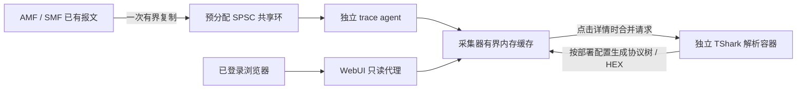

# WebUI 信令详情

事件详情支持 NGAP ASN.1 协议树、5GMM / 5GSM 明文、NGAP 内嵌 Transfer、字段搜索、字段对应字节以及复制。“展开全部”显示所有已解析层级及 PER 编码辅助字段，“收起全部”回到协议树顶层；这两个操作清除搜索条件，节点仍可单独展开。协议树与码流使用同一条事件的 `NF / boot_id / seq` 关联，不根据 IMSI 或相邻时间猜测配对。原有事件摘要和采样路径继续工作。

会话、承载和规则表显示对应会话的 IPv4 / IPv6，双栈地址分行呈现，未分配地址显示 `—`。速率图只提供“折线 / 曲线”下拉框，默认“曲线”，不再提供 2 / 5 / 10 秒平均或独立平滑按钮。两种模式均直接显示相同的原始采样数值，不计算移动平均。

“曲线”使用 ECharts `smooth: 0.25` / `smoothMonotone: 'x'`，仅改变相邻点之间的绘制形状，保留采样点和峰值，不向数据添加虚构的中间采样。连线控制点的纵坐标取各自端点值，曲线不超出相邻点的取值范围；选择“折线”可恢复直线连接。断点不补线，悬浮提示始终显示原始采样数值。线型切换在浏览器执行，不改变采集频率，不触发额外采集或解码。

## 数据路径与性能边界



在新增信令详情采集路径中，AMF / SMF 不生成 JSON、运行 TShark、访问数据库或等待网页请求。生产者使用 C11 原子操作、单生产者单消费者共享内存，先验证边界、容量和速率，再复制。发送 NGAP 在现有 SCTP 发送消耗缓冲前复制，发送结果生成后发布原有事件序号；不保留报文指针。NAS 使用核心网本来就编码或解密后的缓冲，不额外编解码，也不导出核心网安全上下文。完整性校验状态按本条消息记录；失败不会被误标为校验通过。下行 NAS 标记为“发送前明文”，不代表 UE 已收到。

没有修改 UPF / VPP 转发代码，也没有新增用户面锁。采集、上传和解析仍会使用有限 CPU、内存及共享宿主机资源，**不能仅凭架构宣称吞吐和时延完全不受影响**。监控进程绑定空闲 CPU；采集器验证 UPF / VPP 的实际分配，并排除已在运行注解中声明的 AMF / SMF CPU 及其 SMT 同胞。UPF / VPP 分配不可确认或发生重叠时暂停采集和解析。若 AMF 使用共享 CPU 且没有独占分配注解，还需在上线性能验收时核对其实际调度竞争。

| 环节 | 硬限制与超限行为 |
| --- | --- |
| 共享环 | AMF 256 槽、SMF 128 槽，每槽最多 32 KiB；共享 tmpfs 卷上限 32 MiB，启动预分配，失败只停用详情 |
| 核心网复制 | 每 NF 1,000 条/秒且 1 MiB/秒，允许一秒突发；环满、超长或限速时丢弃详情，不等待业务线程 |
| 采集租约 | agent 每约 2 秒续租，最长 6 秒失效；租约失效后跳过复制 |
| agent | 250m CPU / 128 MiB；单批最多 1 MiB / 256 条，上传超时 1 秒，无重试积压队列 |
| 原始 PDU 缓存 | 最多 20,000 条且 64 MiB，按容量淘汰，无时间 TTL |
| 已解析缓存 | 最多 256 条且 32 MiB 编码 JSON；同一事件合并在途任务，解析器版本改变时清空 |
| 采集器总内存 | 容器仍为 512 MiB；实际 cgroup / RSS 达 70% 水位停止接收并回收，降到 55% 后恢复；码流和解析缓存优先回收 |
| 解析器 | 独立容器 500m CPU / 512 MiB；一次一个 PDU，最多排队 64 个事件 ID；子进程 2 秒超时后终止并回收 |
| 解析输出 | PDML 最多 4 MiB、10,000 个节点、深度 64；单条 JSON 最多 1 MiB；HEX 每页 512 字节 |
| WebUI | 登录后的只读令牌，详情不进入浏览器或代理的常规响应缓存，返回 `Cache-Control: no-store` |

编码字节上限不是 Python 实际内存上限，另有对象开销、查询响应和解码临时数据，因此还保留实际内存水位保护。详情不写 MongoDB，重启后不恢复历史码流。摘要与码流独立保留，摘要存在时码流也可能已淘汰。状态接口中的 `signals` 提供数量、字节、淘汰、队列、解析次数/错误、解析器版本和各环丢弃计数；超长/限速等原因目前提供汇总计数，未为每条缺失详情单独保存原因。

## 解码与访问

解析器固定为 TShark 4.6.9，构建校验源码 SHA-256，不启用 Lua、插件、抓包或捕获权限，以非 root、只读根文件系统运行。输入采用 Wireshark Exported PDU 封装，不伪造 SCTP / IP 报头。NGAP APER 和 NAS 使用同一解析器，已验证 NAS Transport 中的 5GSM 以及 PDU Session Resource Setup Transfer 中的 GTP 地址、TEID、QFI 和 5QI。

所有已登录用户均可查看详情。内部上传/解码接口使用现有 Secret 令牌，外部浏览器不能直接访问采集令牌。本测试环境的 `monitor.trace.redactKeys` 默认 `false`，协议树、HEX 和复制内容完整显示，不改变核心网加密算法或转发行为。设置 `true` 可统一遮蔽 `SecurityKey`、`nextHopNH` 等密钥字段、相关祖先值和对应 HEX 字节；此时无正式名称的父节点以“协议项（SecurityKey）”等静态名称说明其内容，不显示含糊的“字段”。该选项不额外导出报文以外的密钥上下文；解码失败或未完整解析时仍不返回 HEX。

密钥显示模式通过部署时的 `TRACE_REDACT_KEYS` 传给采集器和解码器，不接受浏览器请求临时覆盖。模式计入解码版本；切换配置会重建监控服务并清空其内存历史。采集器拒绝缓存不同显示模式的解码结果，避免升级过程混用遮蔽与完整结果。

“查看事件记录（JSON）”展开事件的结构化日志，包括时间、IMSI、协议、方向、结果、事件 ID 和关联标识等；其他详情使用“查看原始记录（JSON）”。“信令内容”中的协议树才是对 NGAP / NAS 报文的解析结果。“已遮蔽”表示主动隐藏敏感字段，与加密后无法解码不同；NAS 明文来自核心网正常解密后的采集位置。

点击详情后的主要解析 CPU 消耗发生在 decoder 容器的 TShark 子进程，使用 `monitor.cpuSet` 并受整个容器 `500m` 总 CPU 配额约束。采集器负责排队、缓存和响应，浏览器负责树形展示。5gc Pod 的 `signal-trace-agent` 只读取 AMF / SMF 共享环并上传，资源上限 `250m / 128 MiB`；解析器不在 5gc Pod 内。

`monitor.trace.decoderPlacement` 支持 `separate`（默认、保留独立解码 Pod）和 `colocated`（monitor、decoder 两个容器放入同一监控 Pod）。两种布局中，`upf-monitor-agent` 与 `signal-trace-agent` 都留在 5gc Pod，共享本地 socket / tmpfs；不能直接把 `emptyDir` 挪给另一个 Pod 使用。合并后 monitor 与 decoder 通过 localhost 通信，仍各自限制 CPU / 内存，分别接受存活探测；解码器没有采集器的 Kubernetes API 令牌挂载。监控 Service 在此布局发布未就绪地址，保证仅 decoder 重启时，仍运行的采集器可以继续提供普通状态 API。Pod 整体重建、节点故障和升级会同时影响两者，因此需要独立升级时使用 `separate`。

## 构建与启用

默认 `monitor.trace.enabled: false`、`monitor.config.trace_enabled: false`。启用基础设施会给共享 5gc Pod 增加 agent、AMF / SMF 环目录和环境变量，**触发整个 5gc Pod 重建，需要维护窗口**。必须使用包含本次 AMF / SMF / libogsproto 的 runtime、包含原生 reader 的 monitor，以及配套 WebUI / decoder 镜像，不能只升级网页。

构建入口为 `monitor/Dockerfile`、`monitor/Dockerfile.decoder` 和现有 WebUI 构建流程。`monitor/Dockerfile.runtime` 接受现行完整 runtime 作为 `BASE_RUNTIME`，构建上下文为 Meson 的 staged install，仅替换 AMF / SMF 和 libogsproto，保留其他 NF / UPF 组件。构建大任务也应使用空闲 CPU。

在现有经审核的部署 values 中合并以下字段，并指定已验证镜像的不可变标签；不要直接用示例覆盖现场其他参数：

```yaml
monitor:
  enabled: true
  cpuSet: "36-37" # 示例，必须按目标机器实际 CPU / SMT 分配确认
  trace:
    enabled: true
    decoderPlacement: colocated
    redactKeys: false # 本测试环境默认完整显示；设为 true 可统一遮蔽密钥
    agentImage:
      repository: localhost:5000/xcn-monitor
      tag: signal-COMMIT
    decoderImage:
      repository: localhost:5000/xcn-trace-decoder
      tag: signal-COMMIT
  config:
    enabled: true
    trace_enabled: true
```

同时设置配套 runtime、collector 和 WebUI 镜像。先执行 `helm lint helm/xcn` 和 `helm template` 审查清单，再在维护窗口按现有 values 升级。Chart 会拒绝在监控或 UE 事件关闭时单独启用 trace。

运行时紧急停用应更新监控 ConfigMap 中的 `trace_enabled` 为 `false`，保留基础设施。配置投射到容器后停止新解析和续租，最迟在最后一次续租后的 6 秒停止核心网复制；这不等于修改 ConfigMap 后 6 秒内必定停用，因为 Kubernetes 配置投射有延迟。无需重建 AMF / SMF。已经解析的缓存仍可读取。停用所有监控的 `config.enabled: false` 同样阻止新的信令任务。不要通过卸载 trace 基础设施作为即时停用手段，这会重建 5gc Pod。

## 验证与发布门槛

可重复运行的测试入口：

```bash
meson test -C build --print-errorlogs amf-location smf-events ue-events ue-trace
python3 -m unittest discover -s monitor/tests -v
node webui/server/tests/monitor-test.js
helm lint helm/xcn
# 在独立 512 MiB 容器中执行；不能在核心网容器里制造内存压力
python3 monitor/tests/signals_soak.py --seconds 3600
```

真实协议语料由 `tests/unit/signal-fixtures.c` 通过本项目 ASN.1 / NAS 编码器生成。设置 `TRACE_FIXTURES` 指向产物目录，并在安装固定版本 TShark 的环境中运行 Python 测试；设置 `XCNCTL` 可同时覆盖原有 CLI 输出兼容性。`monitor/tests/signals.k6.js` 用于隔离环境的 50 用户登录与并发详情测试，支持同一事件和不同事件两种模式。

2026-10-23 隔离验收已覆盖：AMF / SMF 实际构建及四组 C 测试、共享环 ASan / UBSan、NAS 采集开关前后线上编码一致、跨进程原生环到真实解码 API。33 项 Python 用例分别在真实 TShark 和真实 xcnctl 环境运行，每组跳过另一个环境的专属项，两组合计覆盖全部用例。另已验证 WebUI 只读令牌、同请求合并、详情不进入代理缓存，以及真实浏览器的协议树、搜索、字节定位、32 字节密钥遮蔽、现代/HTTP 复制、浅色/深色和 390 px 移动端无页面溢出。

512 MiB 限额的一小时缓存测试持续写入 1,763,300 条合成记录并读取 17,633 次，正常阶段实际内存峰值 127,803,392 字节（约 122 MiB），缓存始终遵守条数和字节上限。结束时另行分配内存触发真实高水位保护，成功回收历史缓存，恢复到约 46.5 MiB 后再次采集成功，进程正常退出。该测试验证缓存容量和回收，不是核心网用户面性能测试。

最终候选镜像的 50 用户压测通过正常 CSRF / 登录 / 只读令牌：同事件 1,295 次监控请求、不同事件 2,779 次，均零失败；接口 P95 分别 26.5 / 35.8 ms，P99 分别 59.4 / 69.8 ms。各用户从首次请求详情到就绪的 P95 分别约 60 ms / 3.07 秒，最长约 1.04 / 4.03 秒；共享事件的后续用户直接使用已解析结果。50 用户查看同一事件只触发一次实际解析，合成 NF 数据源轮询次数始终为零。这证明并发浏览使用缓存并合并解码任务，**不替代实际用户面吞吐和时延验证**。

正式性能验收仍需执行现有监控文档中的四组对比，每组至少三轮，固定 CPU / NIC / VPP 配置，包含原版、修改后关闭、新版开启详情但无浏览者、新版开启且 50 用户浏览。吞吐下降超过 1% 或 P99 时延增加超过 5% 则不通过。低速双向演示流量不能当作线速基线。最初代码交付时未更新现场第 182 版；随后用户明确要求升级当前环境并接入六用户查看页面，演示部署记录如下，不能据此宣布通过正式性能验收。

## 2026-10-23 六用户现场演示

现场 `xcn` / namespace `xcn` 已升级到 Helm revision `183`，入口为 `http://10.2.0.119:9999/`。runtime、monitor（含两个 agent / collector）、WebUI、trace-decoder 使用已验证并推送的 `signal-c41fb3f91` 标签。5gc Pod 为 11 个容器，新增 `signal-trace-agent`；独立解析器主进程实际绑定 CPU `36,37`，总配额 `500m`。原有 N3/N6、VPP / UPF 命令、资源规格和网络配置保留；独占 CPU 由控制器重新分配，采集器已按实际分配重新验证隔离。

复用 OAI gNB，给 gNB 分配 `8 CPU / 2 GiB`，每个 OAI UE 分配 `4 CPU / 1 GiB`。原 `nrue` 对应 IMSI 100，新增 Helm releases `nrue-101`～`nrue-105`，共同接入同一基站，DNN 均为 `cmnet`，每用户一个 PSI 1 会话。新 UE 的 values 补充非空 `podAnnotations`，兼容现有 CPU webhook 对注解父字段的要求。原有五个订阅配置了相同的 `10.45.0.2`；备份后仅修正它们的静态地址，再重新注册，原 IMSI 100 地址保留。

| IMSI | UE IPv4 | 上行目标 Mbps | 下行目标 Mbps |
| --- | --- | --- | --- |
| 460110000000100 | 10.45.0.3 | 0.5 | 1 |
| 460110000000101 | 10.45.0.101 | 1 | 2 |
| 460110000000102 | 10.45.0.102 | 1.5 | 3 |
| 460110000000103 | 10.45.0.103 | 2 | 4 |
| 460110000000104 | 10.45.0.104 | 2.5 | 5 |
| 460110000000105 | 10.45.0.105 | 3 | 6 |

流量使用 UDP / 1,200 字节，目标 `10.2.0.119:15210`～`15221`，每用户分别使用一个上行和一个反向下行进程。逐个核对源地址路由经过 `oaitun_ue1`，生成器绑定各 UE 独占 CPU 内的一个逻辑 CPU，接收服务容器 `xcn-six-ue-traffic-server` 绑定空闲 CPU `38-43`，总配额 `1 CPU / 256 MiB`。每小时一轮自动重连，客户端日志按轮覆盖，服务端日志 `10 MiB × 2` 轮转。网页 UPF 统计约上行 `10.7 Mbps`、下行 `21.5 Mbps`，包含 IP / UDP 开销。

六用户短测中发现 OAI gNB 的 UDP/2152 socket 使用 `212,992` 字节接收缓冲并产生溢出；单独分离线程 CPU 没有消除溢出，已恢复 gNB 原始独占 CPU 掩码。随后通过临时 `gnb-rcvbuf` 工具，只对核实为 gNB 进程、IPv4 `10.2.0.119:2152` 的 UDP socket 调整 `SO_RCVBUFFORCE`，内核报告接收缓冲为 `8 MiB`。主机全局网络参数保持不变。复核时该 socket 丢弃计数保持 `85,887` 不再增长；六路下行最近三个 10 秒窗口、六路上行最近 60 秒共 36 个接收窗口均为零丢包。该设置只作用于当前 socket，gNB 重建后需要按实际进程和 FD 重新应用，不能直接套用旧 FD。

真实浏览器验证了六终端、六用户各一个会话、DNN、六档上下行速率、承载与规则、NGAP 字段搜索和字节定位、32 字节密钥遮蔽、内嵌 Transfer 与 NAS 明文。现场所有核心网容器及新增 UE 均就绪，没有新增容器重启；采集器约 `45 MiB / 512 MiB`，信令环丢弃与上传失败计数为零。

Helm values / manifest、订阅备份、流量参数、临时调优源码与工具、验收日志在本机 `/tmp/xcn-six-users-c41fb3f91/`，目录仅所有者可访问；截图在 `output/playwright/six-ues-*.png`。六用户与灌包保持运行。只停止本次流量、保留终端和核心网：

```bash
python3 /tmp/xcn-six-users-c41fb3f91/stop-traffic.py
```

临时脚本不随 UE Pod 重建自动恢复；重建后需按当前地址和 CPU 分配重新启动流量并复核路由。不能把本次限速演示或接收窗口零丢包当作线速 / P99 性能验收结果。

## 2026-10-24 交互与部署优化验收

完整显示部署为 Helm revision **185**，功能镜像为 `refine-884239f9a`，默认完整显示的部署配置提交为 `fa20736c0`。`monitor.trace.redactKeys=false` 已同时应用于 monitor 与 decoder；协议树、HEX 和复制内容完整显示，仍可显式设置 `true` 切回遮蔽模式。

监控采用 `decoderPlacement=colocated`：两个 agent 留在原 `xcn-5gc` Pod，monitor / decoder 放在一个独立 Pod 的两个容器内，分别限制 CPU / 内存。`xcn-5gc-794bb64998-r8zbr` 与 `xcn-core-699878b7fb-l7hcw` 保持原 Pod，所有核心网容器重启次数仍为零。两个监控进程均绑定 CPU `36-37`；只有 monitor 挂载 Kubernetes API 令牌。原 `xcn-monitor-trace-decoder` Deployment 已移除，兼容 Service 转向合并后的 Pod。

会话、承载、规则视图增加“会话 IP”，支持双栈地址分行展示，并避免 SUPI、PSI / SEID 和速率折行。“查看完整字段”按内容改为“查看事件记录（JSON）”或“查看原始记录（JSON）”。协议树支持展开全部 / 收起全部，涵盖 PER 辅助项、多协议根、深层结构和超过 100 个子字段的情况；搜索后仍可收起。初次部署提供原始 / 10 秒平均视图；随后补充 2 / 5 秒窗口及独立的平滑连线开关，采集路径保持不变。

已验证：

- 监控回归共 38 项，37 项通过，1 项原有 CLI 对照测试因未指定 `XCNCTL` 路径跳过；包含真实 NGAP / NAS 语料、两种密钥显示模式，以及拒绝混用显示模式的缓存检查。
- WebUI 只读代理回归通过；隔离容器中 50 个并发查看请求仅触发一次真实解码，未触发网元采集请求。停止隔离 decoder 后，monitor 的概览与速率 API 仍可使用。
- 两种 Pod 布局、默认完整显示、显式遮蔽及非法配置均通过 Helm 渲染检查；升级前后核心网 Pod 模板一致。网页生产镜像构建通过。
- 真实浏览器通过桌面 / 手机、双栈、全部展开 / 收起、平均视图、事件 JSON 检查；现场通过六会话 IP、真实密钥 / HEX 完整显示、Transfer 字节定位和 NAS 展示检查。验收截图只保留普通标识，不记录实际密钥。
- 2 / 5 / 10 秒窗口通过固定值、不均匀采样、断点恢复与原始数据不变检查。对实际 ECharts 渲染生成的三次曲线逐段检查，控制点及插值均未超过端点范围，采集断点仍分段绘制。
- 隔离生产镜像的真实浏览器确认三种平均窗口结果、平滑 / 折线切换、浅色 / 深色及 390 px 手机布局，运行时错误为零。现场缓存最近五分钟的采样间隔中位数约 2.002 秒，六会话双向流量持续。

监控重建后码流缓存重新积累。为产生现场新信令，仅让 IMSI `460110000000105` 的测试 UE 无线主进程正常退出后在原 Pod 内重启，随后恢复其 `3 Mbps` 上行 / `6 Mbps` 下行；其余五个 UE 与基站保持运行。六用户地址仍与上表一致，最终确认六会话均连接且双向速率非零，六个 UE 内共 12 个 iperf 进程运行。

本次没有修改 AMF / SMF / UPF / VPP 原生代码或添加用户面锁。上述验证确认页面和采集路径正常，不替代线速吞吐或 P99 时延验收。发布备份、升级配置、验收日志保存在仅所有者可访问的 `/tmp/xcn-monitor-refine-1024/`；截图位于 `output/playwright/refine-*.png`。测试终端与灌包继续运行。

随后以 revision **186** 仅更新 WebUI 为 `localhost:5000/xcn-webui:rate-3af250664`，增加 2 / 5 秒平均与独立平滑连线。发布前渲染和发布后实际 Deployment 均确认只有 WebUI Pod 模板发生变化；核心网和 monitor / decoder 保持原 Pod、零新增重启，信令完整显示配置与缓存保留。现场浏览器验证三种平均窗口、平滑 / 折线切换及刷新后选择保持，六会话地址均正常；上行合计约 `10.77 Mbps`、下行约 `21.50 Mbps`，12 个 iperf 进程继续运行。日志为 `browser-rates-live.log` 和 `deployment.rates.final.json`，截图为 `output/playwright/rate-*.png`。
